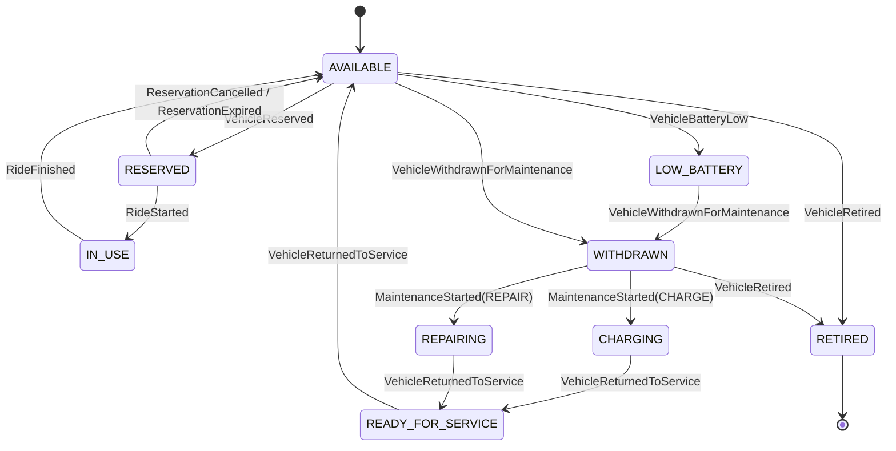

# Plan maestro de UrbanMove

> **Estado:** Fase 0 — cimientos y documentación.
> **Última actualización:** 2026-11-10.
> **Equipo:** 3 personas.
> **Plazo objetivo:** 6-8 semanas (1-2 meses).
> **Repositorio:** <https://github.com/SamuelDiazGonzalezz/UrbanMove>.

---

## 1. Resumen ejecutivo

UrbanMove es un sistema distribuido para gestionar una flota de bicicletas y patinetes
eléctricos repartidos por zonas de una ciudad. El proyecto debe demostrar, como mínimo:

- 10 microservicios atómicos con responsabilidades y datos propios.
- 3 interfaces diferenciadas: usuario, mantenimiento/operaciones y dashboard.
- Comunicación asíncrona mediante un bus, colas y DLQ.
- 3 funciones Lambda conectadas a eventos reales.
- Data Lake con capas raw / trusted / curated.
- Al menos 4 data marts y un dashboard operativo.
- Generación de órdenes de recolocación a partir de la demanda.
- Tolerancia a fallos, escalabilidad y observabilidad.
- CI/CD reproducible con GitHub Actions.
- Documentación arquitectónica: C4, secuencias, propiedad de datos, OpenAPI,
  contratos de eventos y ADRs.

La estrategia elegida es **local-first**: construir y validar todo el sistema en local
con Docker Compose + LocalStack + Keycloak, y desplegar después en AWS Academy o en una
cuenta AWS si el equipo la obtiene. El enunciado permite explícitamente LocalStack,
Docker Compose y alternativas justificadas, así que esta decisión no resta nota y sí
reduce coste, riesgo y dependencia de permisos cloud.

---

## 2. Qué hemos hecho ya

- [x] Leer y analizar el enunciado completo (14 páginas).
- [x] Identificar los mínimos obligatorios y la rúbrica.
- [x] Decidir la arquitectura base: local-first, Docker Compose, PostgreSQL,
      Keycloak, EventBridge + SQS, Kappa + Medallón.
- [x] Eliminar la implementación anterior de referencia.
- [x] Inicializar git y conectar el repositorio de GitHub.
- [x] Crear la estructura documental y este plan maestro.
- [x] Documentar las decisiones iniciales en ADRs.
- [x] Dejar el repositorio solo con documentación para la revisión del equipo.

**Lo que no se ha hecho todavía:** no hay código de negocio, ni `docker-compose.yml`,
ni POM padre, ni pipeline, ni estructura de carpetas de implementación. Eso es la
Fase 0, y no se empieza hasta que el equipo valide el plan.

---

## 3. Contexto y alcance

### 3.1. Dominio

La empresa ficticia gestiona bicicletas y patinetes en zonas de la ciudad. Los usuarios
pueden registrarse, consultar recursos cercanos, reservar, iniciar un viaje, finalizarlo
y dejarlo en una zona permitida. El personal de mantenimiento puede retirar recursos para
recargarlos, repararlos o revisarlos, y volver a ponerlos en servicio. El sistema debe
recoger eventos de uso y operación en un Data Lake para construir data marts y decidir
recolocaciones de flota.

### 3.2. Alcance del proyecto

Incluye:

- Microservicios de negocio y sus APIs REST.
- Funciones Lambda de expiración, detección de mantenimiento, ingesta analítica,
  construcción de marts y recolocación.
- Bus de eventos, colas, DLQ y patrón outbox.
- Data Lake y data marts.
- Dashboard operativo.
- Autenticación y roles.
- CI/CD, infraestructura como código y observabilidad.
- Documentación y guion de demo.

No incluye:

- Pasarela de pago real.
- App móvil nativa.
- Mapas reales o geolocalización de alta precisión.
- Machine learning avanzado (solo ampliación sencilla si sobra tiempo).
- Producción real, alta disponibilidad multirregión o cumplimiento legal.

---

## 4. Restricciones y supuestos

| Restricción / supuesto | Implicación |
|---|---|
| 3 personas | Reparto por dominios; integración semanal; contratos primero |
| 1-2 meses | Roadmap de 6-8 semanas; recortar ampliaciones antes que mínimos |
| AWS no confirmado | LocalStack + Docker Compose como base; AWS es despliegue posterior |
| Repositorio público | Cero secretos; `.env` ignorado; OIDC en AWS |
| Interfaz no prioritaria | Swagger/Postman + Grafana por defecto; web propia opcional |
| Enunciado permite LocalStack | No dependemos de una cuenta AWS para aprobar |
| Equipo empieza desde cero | Fase 0 de plataforma antes de escribir microservicios |

---

## 5. Requisitos del enunciado

### 5.1. Mínimos para aprobar

| Requisito | Mínimo | Estado |
|---|---|---|
| Interfaces diferenciadas | Usuario, mantenimiento/operaciones y dashboard | Diseñado |
| Microservicios atómicos | 10, con los obligatorios del enunciado | Diseñado |
| Historial independiente | Servicio propio, no una tabla secundaria | Diseñado |
| Documentación arquitectónica | C4, secuencias, propiedad de datos, APIs, eventos, 2 ADRs | En curso |
| Lambdas | 3 conectadas a eventos reales | Diseñado |
| Mensajería | Al menos un bus/cola/tópico | Diseñado |
| Data Lake | raw / trusted / curated | Diseñado |
| Data marts | Al menos 4 | Diseñado |
| Recolocación | Órdenes generadas desde demanda | Diseñado |
| Dashboard | Flota, reservas, viajes, mantenimiento, recolocación y salud | Diseñado |
| Tolerancia a fallos | 4 mecanismos y 2 fallos probados/simulados | Diseñado |
| Escalabilidad | Justificar horizontal/eventos y 2 cuellos de botella | Diseñado |
| DevOps | Tests, imágenes, análisis estático, Lambdas, migraciones, evidencias | Pendiente |
| PDF final y defensa | Todos los miembros | Pendiente |

### 5.2. Microservicios obligatorios

1. Identidad.
2. Perfiles de usuario.
3. Inventario de recursos.
4. Disponibilidad.
5. Reservas.
6. Viajes.
7. Historial.
8. Órdenes de mantenimiento.
9. Órdenes de recolocación.
10. Analítica operacional.

> No se pueden fusionar reservas, viajes, historial, mantenimiento ni analítica.
> Las fusiones de servicios de bajo riesgo deben justificarse en el informe.

### 5.3. Eventos obligatorios

`UserRegistered`, `VehiclePurchased`, `VehicleReserved`, `ReservationCancelled`,
`ReservationExpired`, `RideStarted`, `RideFinished`, `VehicleBatteryLow`,
`VehicleWithdrawnForMaintenance`, `VehicleReturnedToService`,
`DemandHotspotDetected`, `RelocationOrderCreated`, `RelocationOrderCompleted`.

Cada evento debe incluir identificador, timestamp, origen, tipo, versión de esquema y
identificador de correlación. El catálogo completo está en [`EVENTS.md`](../01-arquitectura/EVENTS.md).

### 5.4. Flujos obligatorios de la defensa

1. Flujo de usuario.
2. Flujo de mantenimiento.
3. Flujo de analítica y recolocación.
4. Flujo de dashboard.
5. Flujo de fallo controlado.

El guion detallado está en la sección 24.

---

## 6. Decisiones arquitectónicas

| Decisión | Elección | Alternativas descartadas | ADR |
|---|---|---|---|
| Estrategia de desarrollo | Local-first con Docker Compose + LocalStack | AWS desde el día 1; solo local sin cloud | [0001](../01-arquitectura/adr/0001-local-first-docker-compose.md) |
| Base de datos operacional | PostgreSQL por servicio | DynamoDB, MySQL, MongoDB | [0002](../01-arquitectura/adr/0002-postgresql-vs-dynamodb.md) |
| Topología de base de datos | Dos instancias RDS: operacional (13 BD: 12 de servicio + `keycloak_db`) y analítica (1 BD). Plan B: una instancia con 14 BD | Una sola instancia desde el inicio, 13 instancias, Aurora Serverless | [0006](../01-arquitectura/adr/0006-dos-instancias-rds.md) |
| Organización analítica | Kappa + Medallón (raw/trusted/curated) | Lambda architecture, batch-only, Data Mesh | [0003](../01-arquitectura/adr/0003-kappa-medallion.md) |
| Identidad | Keycloak local / Cognito AWS + JWT | Login propio, Spring Authorization Server | [0004](../01-arquitectura/adr/0004-keycloak-vs-cognito.md) |
| Dashboard | Grafana + PostgreSQL + Prometheus | React propio, Metabase, Superset | [0005](../01-arquitectura/adr/0005-grafana-dashboard.md) |
| Mensajería | EventBridge + SQS + DLQ | Kafka/MSK, RabbitMQ, SNS puro | 0003 |
| Cómputo | Docker Compose local; EC2/ECS solo si hay AWS | EKS desde el inicio | 0001 |
| IaC | Terraform | CloudFormation, CDK, SAM | 0001 |
| CI/CD | GitHub Actions + GHCR / ECR | Jenkins, GitLab CI | Ver CI-CD |
| Observabilidad | Actuator + Micrometer + Prometheus + Grafana | Solo CloudWatch | 0005 |

### 6.1. ¿Y DynamoDB?

S3 **no es una base de datos operacional**: es almacenamiento de objetos para el Data
Lake. La base de datos transaccional del sistema es **PostgreSQL**, una base de datos
por microservicio. DynamoDB se ha considerado y se descarta para el núcleo porque:

- Reservas y disponibilidad necesitan restricciones relacionales y transacciones
  claras para evitar dobles reservas.
- Los data marts y las consultas agregadas son más naturales en SQL.
- Añadir DynamoDB obliga a un segundo paradigma de modelado y a más configuración local.

DynamoDB queda como **ampliación opcional** para telemetría o para un read model de
disponibilidad de altísima escritura. La justificación completa está en el
[ADR 0002](../01-arquitectura/adr/0002-postgresql-vs-dynamodb.md).

### 6.2. Dos instancias RDS y plan B

La base operacional se despliega en una instancia RDS y los data marts en otra, para
que la analítica no compita con reservas y viajes. Si AWS Academy o el crédito impiden
mantener dos instancias, se colapsa a una sola instancia con las 14 bases: el código no
cambia, solo la variable `DB_HOST` de `analytics` y de `mart-builder`.

El detalle completo —topologías, permisos, coste, migración y disparadores del plan B—
está en [`DATA-ARCHITECTURE.md`](../01-arquitectura/DATA-ARCHITECTURE.md) y en el
[ADR 0006](../01-arquitectura/adr/0006-dos-instancias-rds.md).

### 6.3. OLTP y OLAP

La carga transaccional (reservas, viajes, disponibilidad) y la analítica (marts,
paneles) se separan **siempre a nivel lógico**: ningún panel consulta una base
operacional y ningún servicio escribe en `analytics_db`. En local conviven en un
contenedor; en AWS van en dos instancias RDS. La discusión completa —definiciones,
flujo de un evento, consistencia, rendimiento, topologías local y AWS y anti-patrones—
está en [`OLTP-OLAP.md`](../01-arquitectura/OLTP-OLAP.md).

---

## 7. Arquitectura objetivo

```text
┌──────────────────────────────────────────────────────────────────────────────┐
│                              CLIENTES / INTERFACES                          │
│  App usuario (Swagger/Postman)   App operaciones (Swagger/Postman)          │
│  Dashboard operativo (Grafana)                                              │
└───────────────────────────────┬──────────────────────────────────────────────┘
                                │ HTTPS + JWT
                                ▼
┌──────────────────────────────────────────────────────────────────────────────┐
│                         EDGE: API Gateway / Nginx                            │
│                    Validación JWT, rate limit, CORS                          │
│                    Keycloak (local) / Cognito (AWS)                          │
└───────────────────────────────┬──────────────────────────────────────────────┘
                                │
        ┌───────────────────────┼───────────────────────────┐
        ▼                       ▼                           ▼
┌───────────────┐      ┌─────────────────┐        ┌──────────────────┐
│  SERVICIOS    │      │   MENSAJERÍA    │        │   SERVERLESS     │
│  atómicos     │─────▶│ EventBridge     │───────▶│ 5 Lambdas        │
│  (13)         │      │ + SQS + DLQ     │        │ expiración,      │
│               │      │                 │        │ mantenimiento,   │
│               │      │                 │        │ ingesta, marts,  │
│               │      │                 │        │ recolocación     │
└───────┬───────┘      └────────┬────────┘        └────────┬─────────┘
        │                       │                          │
        ▼                       ▼                          ▼
┌───────────────┐      ┌─────────────────┐        ┌──────────────────┐
│ PostgreSQL    │      │ S3 Data Lake    │        │ Data marts       │
│ una BD por    │      │ raw/trusted/    │        │ PostgreSQL       │
│ servicio      │      │ curated         │        │ analytics        │
└───────────────┘      └─────────────────┘        └──────────────────┘
```

### 7.1. Flujo de un evento

1. Un servicio guarda el cambio de negocio y el evento en su tabla `outbox_event`
   dentro de la misma transacción.
2. Un relay publica el evento en EventBridge.
3. EventBridge lo enruta a las colas SQS de los consumidores y a la Lambda de ingesta.
4. Cada consumidor procesa de forma idempotente y, si falla, reintenta o va a DLQ.
5. La Lambda de ingesta escribe el evento en S3 raw, particionado.
6. Las Lambdas de marts construyen trusted/curated y actualizan los data marts.
7. El dashboard consulta los marts y las métricas.

---

## 8. Catálogo de microservicios

| # | Servicio | Responsabilidad | Base de datos | Estado |
|---|---|---|---|---|
| 1 | `identity` | Registro, roles, sesión y fachada sobre el IdP | `identity_db` | Pendiente |
| 2 | `user-profiles` | Perfil, preferencias y baja lógica | `profiles_db` | Pendiente |
| 3 | `zones` | Zonas, restricciones y metadatos geográficos | `zones_db` | Pendiente |
| 4 | `inventory` | Activos físicos y adquisiciones | `inventory_db` | Pendiente |
| 5 | `availability` | Estado operativo y zona actual | `availability_db` | Pendiente |
| 6 | `telemetry` | Batería, ubicación, km y usos | `telemetry_db` | Pendiente |
| 7 | `reservations` | Reserva, confirmación, cancelación y expiración | `reservations_db` | Pendiente |
| 8 | `rides` | Inicio, fin, duración y coste preliminar | `rides_db` | Pendiente |
| 9 | `incidents` | Averías, vandalismo, bloqueos y recursos perdidos | `incidents_db` | Pendiente |
| 10 | `maintenance` | Órdenes de retirada, recarga, reparación y reincorporación | `maintenance_db` | Pendiente |
| 11 | `relocation` | Órdenes de recolocación entre zonas | `relocation_db` | Pendiente |
| 12 | `history` | Historial independiente construido por eventos | `history_db` | Pendiente |
| 13 | `analytics` | Consultas agregadas sobre data marts | `analytics_db` | Pendiente |

### 8.1. Servicios finos y fusiones

- `zones`, `telemetry` e `incidents` son servicios finos: un agregado, 2-4 endpoints y
  eventos claros. Se incluyen porque los flujos funcionales los necesitan.
- `adquisiciones` se integra en `inventory` (bajo riesgo, justificado).
- `notificaciones` se implementa como Lambda/consumidor simple, no como microservicio
  obligatorio.
- Si el tiempo aprieta, `incidents` puede integrarse en `maintenance` y `telemetry`
  en `availability`, siempre que se justifique y no se toquen los cinco servicios
  prohibidos de fusión.

---

## 9. Propiedad de datos

| Entidad / tabla | Servicio propietario | Consumidores |
|---|---|---|
| `user_account`, `role_assignment` | `identity` | `user-profiles`, `history` |
| `user_profile` | `user-profiles` | `identity`, `history` |
| `zone`, `zone_restriction` | `zones` | `availability`, `rides`, `relocation`, `analytics` |
| `vehicle_asset`, `acquisition` | `inventory` | `availability`, `telemetry`, `maintenance`, `history` |
| `vehicle_availability` | `availability` | `reservations`, `rides`, `maintenance`, `analytics` |
| `telemetry_reading` | `telemetry` | `maintenance`, `analytics` |
| `reservation`, `reservation_attempt` | `reservations` | `rides`, `analytics`, `history` |
| `ride` | `rides` | `history`, `analytics` |
| `incident` | `incidents` | `maintenance`, `history` |
| `maintenance_order`, `maintenance_task` | `maintenance` | `availability`, `history`, `analytics` |
| `relocation_order` | `relocation` | `history`, `analytics` |
| `history_entry` | `history` | `analytics` (solo lectura) |
| `mart_*` | `analytics` | Dashboard |

**Regla:** ningún servicio lee ni escribe directamente la base de datos de otro.
La integración es por API o por evento.

---

## 10. Estados y transiciones

El enunciado exige estos estados para cada recurso:

`AVAILABLE`, `RESERVED`, `IN_USE`, `LOW_BATTERY`, `WITHDRAWN`, `CHARGING`,
`REPAIRING`, `READY_FOR_SERVICE`, `RETIRED`.

### 10.1. Separación de responsabilidades

- **Inventario** posee el estado administrativo: `REGISTERED`, `ACTIVE`, `RETIRED`.
- **Disponibilidad** posee el estado operativo: los nueve estados del enunciado.
- **Reservas, viajes, mantenimiento y telemetría** no escriben directamente la tabla de
  disponibilidad: publican eventos y `availability` valida y aplica la transición.

### 10.2. Máquina de estados operativa



| Transición | Evento | Servicio que valida |
|---|---|---|
| `AVAILABLE → RESERVED` | `VehicleReserved` | `availability` |
| `RESERVED → IN_USE` | `RideStarted` | `availability` |
| `RESERVED → AVAILABLE` | `ReservationCancelled` / `ReservationExpired` | `availability` |
| `IN_USE → AVAILABLE` | `RideFinished` | `availability` |
| `AVAILABLE → LOW_BATTERY` | `VehicleBatteryLow` | `availability` |
| `LOW_BATTERY/AVAILABLE → WITHDRAWN` | `VehicleWithdrawnForMaintenance` | `availability` |
| `WITHDRAWN → CHARGING/REPAIRING` | `MaintenanceStarted` | `maintenance` + `availability` |
| `CHARGING/REPAIRING → READY_FOR_SERVICE` | `VehicleReturnedToService` | `maintenance` |
| `READY_FOR_SERVICE → AVAILABLE` | `VehicleReturnedToService` | `availability` |
| `AVAILABLE/WITHDRAWN → RETIRED` | `VehicleRetired` | `inventory` + `availability` |

---

## 11. Eventos

El catálogo completo, el sobre común, las reglas de versionado, el patrón outbox, la
idempotencia y la DLQ están en [`EVENTS.md`](../01-arquitectura/EVENTS.md).

Resumen del sobre:

```json
{
  "eventId": "uuid",
  "eventType": "RideFinished",
  "eventVersion": 1,
  "occurredAt": "2026-11-10T18:30:00Z",
  "source": "rides-service",
  "correlationId": "uuid",
  "causationId": "uuid",
  "producer": "rides-service",
  "payload": {}
}
```

---

## 12. Data Lake y data marts

### 12.1. Enfoque: Kappa + Medallón

- **Kappa:** todos los eventos entran por un único pipeline de streaming; el log de
  eventos es la fuente de verdad. Para reprocesar, se reproduce el log.
- **Medallón:** el lago se organiza en `raw`, `trusted` y `curated`.
- No hay una capa batch separada como en Lambda architecture. El batch se sustituye por
  reprocesamiento del log cuando hace falta.

### 12.2. Particionado

```text
s3://urbanmove-datalake/raw/source=rides/event_type=RideFinished/year=2026/month=11/day=10/hour=18/
s3://urbanmove-datalake/trusted/event_type=RideFinished/year=2026/month=11/day=10/
s3://urbanmove-datalake/curated/domain=demand/year=2026/month=11/day=10/
```

- `raw`: JSON/JSONL tal cual llega, inmutable.
- `trusted`: validado, deduplicado por `eventId`, normalizado y en Parquet.
- `curated`: agregados listos para los marts.

Un solo bucket con tres prefijos (no *tags*). La inmutabilidad de `raw` se garantiza con
claves únicas por `eventId`, Versioning y, en AWS, Object Lock. El detalle está en
[`DATA-ARCHITECTURE.md`](../01-arquitectura/DATA-ARCHITECTURE.md), sección 5.

### 12.3. Data marts

| Mart | Pregunta que responde | Prioridad |
|---|---|---|
| `mart_usuarios` | Usuarios activos, viajes y cancelaciones por usuario | Alta |
| `mart_reservas` | Reservas caducadas, conversión y zonas con reservas no usadas | Alta |
| `mart_viajes` | Orígenes/destinos frecuentes, duración media, viajes por franja | Alta |
| `mart_flota` | Disponibles, reservados, en uso, carga y reparación por zona | Alta |
| `mart_mantenimiento` | Recursos que requieren recarga/reparación y tiempo fuera de servicio | Alta |
| `mart_operaciones` | Órdenes de recolocación creadas/completadas y retraso | Media |
| `mart_demanda` | Déficit/exceso por zona, franja horaria y tipo de recurso | Alta |

Mínimo obligatorio: 4. Objetivo: 7. Si el tiempo aprieta, se priorizan
`mart_viajes`, `mart_flota`, `mart_mantenimiento` y `mart_demanda`.

Los marts se materializan en `analytics_db`, dentro de la instancia RDS analítica, y son
**proyecciones reconstruibles**: se pueden borrar y recalcular desde los eventos. Ver
[`DATA-ARCHITECTURE.md`](../01-arquitectura/DATA-ARCHITECTURE.md), secciones 8 y 9.

### 12.4. Regla de recolocación

Cada 5 minutos, la Lambda `demand-relocation` consulta `mart_demanda`:

> Si una zona tiene menos de 3 recursos disponibles y ha tenido más de 10 intentos de
> reserva o viajes iniciados en la última hora, se genera una orden para mover recursos
> desde una zona con exceso.

La orden se publica como `RelocationOrderCreated` y la app de mantenimiento la consulta
y la completa.

---

## 13. Funciones Lambda

| Lambda | Disparador | Entrada | Salida | Obligatoria |
|---|---|---|---|---|
| `reservation-expiration` | EventBridge Scheduler cada minuto | Reservas pendientes | `ReservationExpired` + liberación | Sí |
| `maintenance-detection` | Evento de telemetría | `VehicleTelemetryReceived` | `VehicleBatteryLow` + orden | Sí |
| `analytics-ingest` | Evento de dominio | Cualquier evento | Objeto en S3 raw | Sí |
| `mart-builder` | EventBridge Scheduler | Raw/trusted nuevos | Parquet + marts actualizados | Ampliación |
| `demand-relocation` | EventBridge Scheduler | `mart_demanda` | `DemandHotspotDetected` + `RelocationOrderCreated` | Ampliación |

Las tres primeras son las obligatorias del enunciado; las otras dos son ampliación y
además habilitan el flujo de recolocación.

---

## 14. Seguridad y autenticación

### 14.1. Login

- **Local:** Keycloak en Docker, realm `urbanmove`, roles `USER`, `MAINTENANCE`, `ADMIN`.
- **AWS:** Cognito User Pool con grupos equivalentes.
- Flujo OIDC Authorization Code + PKCE.
- La app obtiene un JWT y lo envía como `Authorization: Bearer <token>`.
- Cada servicio valida el JWT con Spring Security (`oauth2-resource-server`) contra el
  `issuer-uri` y el JWKS.
- El servicio `identity` actúa como fachada de administración de usuarios y roles; los
  tokens y sesiones los gestiona el IdP. Esta decisión está en el
  [ADR 0004](../01-arquitectura/adr/0004-keycloak-vs-cognito.md).

### 14.2. Secretos

- `.env` ignorado; solo `.env.example` versionado.
- Keycloak local con credenciales de desarrollo claramente marcadas.
- AWS: Secrets Manager o SSM Parameter Store.
- GitHub Actions → AWS con OIDC; nunca claves de larga duración.
- Nada de secretos en logs; el filtro de logging debe enmascarar tokens y contraseñas.
- Escaneo de secretos (GitHub secret scanning + gitleaks) antes de cada push.

### 14.3. Otras medidas

- Validación de entrada con Bean Validation.
- Rate limiting en el edge.
- CORS restringido.
- TLS en AWS; HTTP solo en local.
- IAM de mínimo privilegio.
- Escaneo de dependencias e imágenes (Trivy, Dependabot, CodeQL).
- Contenedores no-root.
- Limpieza de recursos documentada.

---

## 15. Tolerancia a fallos

Mecanismos que se implementarán (mínimo 4):

| Mecanismo | Implementación |
|---|---|
| Reintentos controlados | Resilience4j en llamadas síncronas; reintentos de SQS |
| Colas/tópicos | EventBridge + SQS por consumidor |
| Dead-letter queue | DLQ por cola + alarma |
| Idempotencia | Tabla `processed_event(event_id)` en cada consumidor |
| Timeouts | Timeouts explícitos en HTTP y clientes |
| Degradación funcional | El viaje termina aunque historial o notificaciones fallen |
| Health checks | Actuator liveness/readiness y reinicio de contenedores |
| Persistencia antes de procesar | Patrón outbox en la base de datos del productor |

### 15.1. Escenarios de fallo para la demo

1. **Historial caído:** se para `history`, se completa un viaje, el evento queda en SQS
   y el flujo de usuario termina. Al reiniciar `history`, se procesa el mensaje y
   aparece en el historial. Evidencia: logs con `correlationId`, profundidad de cola
   antes/después.
2. **Lambda de marts fallando:** se fuerza un error, el evento queda en DLQ o en raw,
   y al reprocesar se reconstruye el mart. Evidencia: objeto en raw, mensaje en DLQ,
   mart recuperado.

También se probará la duplicación de un evento para demostrar idempotencia y la
expiración de una reserva.

---

## 16. Escalabilidad

- Servicios **stateless**; escalado horizontal con Compose `--scale` o ECS desired count.
- SQS absorbe picos y desacopla a los consumidores.
- Lambdas escalan en paralelo por evento.
- Data Lake particionado por fecha, tipo de evento y origen.
- Marts incrementales por ventana temporal; no se recalcula todo.
- Analítica separada de la base de datos operacional: nunca bloquea reservas ni viajes.
- **Dos instancias RDS** (operacional y analítica) desde el inicio; una instancia por
  servicio solo si un dominio concreto lo exige.
- Pool de conexiones y réplicas de lectura si hiciera falta.

### 16.1. Cuellos de botella y mitigación

| Cuello de botella | Mitigación |
|---|---|
| Escrituras concurrentes en reservas/disponibilidad | Bloqueo optimista (`@Version`), restricción única de reserva activa, idempotencia |
| Consultas analíticas pesadas | Data marts precalculados, caché, réplica de lectura, Athena/DuckDB |
| Crecimiento del Data Lake | Particionado, Parquet comprimido, retención y reprocesamiento por ventana |
| Saturación de logs | Niveles configurables, muestreo y retención |

---

## 17. CI/CD y observabilidad

El diseño detallado está en [`CI-CD.md`](../03-operacion/CI-CD.md).

Resumen:

- `ci.yml`: compilar, testear, analizar y validar contratos en cada PR.
- `integration.yml`: levantar Compose + LocalStack + Keycloak y ejecutar E2E.
- `cd.yml`: construir imágenes, publicar en GHCR/ECR y desplegar.
- `infra.yml`: Terraform `fmt`, `validate`, `plan`.
- `security.yml`: CodeQL, Trivy, SBOM y Dependabot.

Observabilidad:

- Logs JSON con `correlationId`.
- Métricas de reservas, viajes, recursos disponibles, órdenes y DLQ.
- Prometheus + Grafana.
- Actuator health/liveness/readiness.
- CloudWatch si se despliega en AWS.

---

## 18. Estructura prevista del repositorio

> Esta estructura se creará en la Fase 0, cuando el equipo valide el plan. Ahora mismo
> el repositorio solo contiene documentación.

```text
urbanmobility/
├── services/              # 13 microservicios previstos
├── lambdas/               # 5 funciones serverless
├── infra/                 # Terraform + LocalStack
├── contracts/             # OpenAPI, AsyncAPI y JSON Schema
├── clients/               # Swagger/Postman + Grafana
├── docs/                  # Documentación (ver docs/README.md)
│   ├── 00-gestion/
│   ├── 01-arquitectura/
│   ├── 02-desarrollo/
│   ├── 03-operacion/
│   └── 04-enunciado/
├── scripts/               # Seed, demo y utilidades
├── .github/workflows/     # CI/CD
├── docker-compose.yml     # Fase 0
├── pom.xml                # Fase 0
├── Makefile
├── .env.example
└── README.md
```

---

## 19. Roadmap por fases

Plazo objetivo: 6-8 semanas. Si la entrega es más ajustada, se recortan las fases 3 y 4
y se mantienen los mínimos.

> El orden concreto de servicios, sus dependencias y los recortes permitidos están en
> [SERVICE-ROADMAP.md](../01-arquitectura/SERVICE-ROADMAP.md). Las tareas se trazan con
> issues y etiquetas, no con milestones: ver
> [GITHUB-WORKFLOW.md](GITHUB-WORKFLOW.md).

### Fase 0 — Cimientos (semana 1)

Objetivo: que cualquier persona pueda levantar el entorno local y ver algo funcionando.

- [ ] `docker-compose.yml` con PostgreSQL, LocalStack, Keycloak, Grafana y Prometheus.
- [ ] POM padre + plantilla de microservicio hexagonal.
- [ ] Realm de Keycloak importado con roles y usuarios de desarrollo.
- [ ] Scripts `dev.ps1`, `seed` y `cleanup`.
- [ ] CI mínimo (build + tests + formato).
- [ ] ADRs 0001-0005.
- [ ] Contratos iniciales y `AsyncAPI` vacío.

**Hecho cuando:** `docker compose up` levanta todo; un servicio de prueba responde; el
CI está verde.

### Fase 1 — Flujo de usuario (semanas 2-3)

Objetivo: primer flujo completo end-to-end y walking skeleton.

- [ ] `identity`, `user-profiles`, `zones`, `inventory`, `availability`,
      `reservations`, `rides`, `history`.
- [ ] Keycloak + Spring Security + roles.
- [ ] Eventos `UserRegistered`, `VehiclePurchased`, `VehicleReserved`,
      `ReservationCancelled`, `RideStarted`, `RideFinished`.
- [ ] Outbox + EventBridge + SQS + DLQ.
- [ ] Lambda `analytics-ingest` escribiendo raw en S3.
- [ ] Primer mart (`mart_viajes` o `mart_reservas`).
- [ ] Dashboard Grafana con 2-3 paneles.
- [ ] Colección Postman/Swagger para la app de usuario.

**Hecho cuando:** registro → reserva → viaje → fin → historial → evento en S3 → panel.

### Fase 2 — Flujo de mantenimiento (semanas 4-5)

Objetivo: segundo flujo completo y primera Lambda de negocio.

- [ ] `telemetry`, `incidents`, `maintenance`.
- [ ] Lambdas `reservation-expiration` y `maintenance-detection`.
- [ ] Eventos `VehicleBatteryLow`, `VehicleWithdrawnForMaintenance`,
      `VehicleReturnedToService`, `ReservationExpired`.
- [ ] Transiciones de estado completas.
- [ ] Marts `mart_flota` y `mart_mantenimiento`.
- [ ] Colección Postman/Swagger para operaciones.

**Hecho cuando:** batería baja → orden → retirada → recarga/reparación → vuelta al
servicio → historial y mart actualizados.

### Fase 3 — Analítica y recolocación (semanas 5-6)

Objetivo: capa analítica y decisión operacional.

- [ ] `relocation` y `analytics`.
- [ ] Lambdas `mart-builder` y `demand-relocation`.
- [ ] trusted/curated y marts restantes.
- [ ] Regla de déficit/exceso y órdenes de recolocación.
- [ ] Dashboard con los indicadores del enunciado.
- [ ] Consultas de ejemplo documentadas.

**Hecho cuando:** se simulan viajes, se actualiza `mart_demanda`, se detecta déficit y
se crea/completa una orden de recolocación.

### Fase 4 — Fallos, escalabilidad y observabilidad (semana 7)

- [ ] DLQ, reintentos, idempotencia y timeouts comprobados.
- [ ] Dos escenarios de fallo documentados con evidencias.
- [ ] Prueba de carga con Locust.
- [ ] Métricas, logs y trazas con correlación.
- [ ] Demostración de escalado horizontal.
- [ ] Análisis de cuellos de botella.

### Fase 5 — Cierre y defensa (semana 8)

- [ ] Documentación final: C4, secuencias, propiedad de datos, OpenAPI, AsyncAPI, ADRs.
- [ ] PDF final y reparto del trabajo.
- [ ] Terraform/LocalStack reproducible.
- [ ] Despliegue AWS Academy si hay cuenta.
- [ ] Ensayo de los 5 flujos en menos de 10 minutos.
- [ ] Limpieza de recursos y sección de coste.

---

## 20. Reparto del equipo

Propuesta inicial para 3 personas; se ajustará según disponibilidad y avance.

| Persona | Dominio | Servicios / tareas |
|---|---|---|
| **A** | Usuario | `identity`, `user-profiles`, `reservations`, `rides`, app de usuario, pruebas de esos servicios |
| **B** | Operaciones | `inventory`, `availability`, `telemetry`, `incidents`, `maintenance`, `relocation`, app de operaciones, Lambdas de expiración y detección |
| **C** | Datos y plataforma | `zones`, `history`, `analytics`, Data Lake, data marts, dashboard, Lambdas de ingesta/marts/demanda, CI/CD e infraestructura |

**Trabajo conjunto obligatorio:** arquitectura, contratos de API y eventos, integración,
CI/CD, despliegue, pruebas E2E, observabilidad, informe y defensa.

Reglas de coordinación:

- Contratos primero: OpenAPI y JSON Schema antes de implementar.
- Integración semanal: cada viernes se levanta todo el sistema y se ejecutan los flujos.
- Ramas cortas y PRs pequeños; `main` siempre verde.
- Ningún servicio accede a la base de datos de otro.
- Las decisiones que afecten a todos se documentan como ADR.

---

## 21. Checklist de progreso

### Hecho

- [x] Analizar el enunciado.
- [x] Reset del repositorio y limpieza de la implementación anterior.
- [x] Git inicializado y conectado a GitHub.
- [x] Plan maestro y documentación inicial.
- [x] ADRs iniciales.
- [x] Repositorio dejado solo con documentación para revisión.

### Fase 0

- [ ] `docker-compose.yml`.
- [ ] POM padre y plantilla de servicio.
- [ ] Keycloak + realm.
- [ ] LocalStack + buckets/colas.
- [ ] Grafana + Prometheus.
- [ ] CI mínimo.
- [ ] Contratos base.

### Fase 1

- [ ] 8 servicios del flujo de usuario.
- [ ] Autenticación y roles.
- [ ] Outbox + bus + DLQ.
- [ ] Lambda de ingesta.
- [ ] Primer mart.
- [ ] Dashboard inicial.
- [ ] Postman/Swagger.

### Fases 2-5

- [ ] Mantenimiento.
- [ ] Analítica y recolocación.
- [ ] Fallos y carga.
- [ ] Documentación final y demo.

---

## 22. Riesgos y mitigaciones

| Riesgo | Impacto | Mitigación |
|---|---|---|
| Alcance excesivo para 1-2 meses | Alto | Priorizar los 10 obligatorios; recortar extras; integración semanal |
| No hay cuenta AWS | Medio | LocalStack + Compose; AWS es opcional y posterior |
| Permisos limitados en AWS Academy | Medio | Desplegar solo lo permitido; documentar; no depender de OIDC |
| Curva de Keycloak/Cognito | Medio | Usar Keycloak local y plantilla de Spring Security; no implementar login propio |
| Curva de Docker/Testcontainers en Windows | Medio | Docker Desktop + WSL2; documentar solución; CI en Linux |
| Equipo descoordinado | Alto | Contratos primero; PRs pequeños; integración semanal |
| Data marts complejos | Medio | Empezar con 4 marts en SQL; Lambdas + DuckDB/PostgreSQL |
| Pérdida de eventos | Alto | Outbox, DLQ y pruebas de fallo |
| Secretos en el repo | Alto | `.env`, secret scanning, OIDC, revisión antes de commit |
| Demo falla en directo | Alto | Ensayo desde cero; datos semilla; plan B local |

---

## 23. Coste y recursos AWS

### 23.1. Local

Coste: **0 €**. Todo corre en Docker (PostgreSQL, LocalStack, Keycloak, Grafana,
Prometheus) y en GitHub Actions.

### 23.2. AWS Academy o cuenta real

Si hay cuenta:

- Preferir **una sola EC2** con Docker Compose para los servicios.
- Usar S3, SQS, EventBridge, Lambda y CloudWatch como servicios gestionados.
- Evitar NAT Gateway, EKS, MSK y Redshift: son caros y no aportan al mínimo.
- **Dos instancias RDS** (operacional y analítica) como objetivo. Si el crédito o los
  límites de la cuenta no lo permiten, **una sola instancia con las 14 bases**: el código
  no cambia, solo `DB_HOST`. Ver [`DATA-ARCHITECTURE.md`](../01-arquitectura/DATA-ARCHITECTURE.md),
  sección 13.
- Si RDS no está disponible en la cuenta, PostgreSQL en la propia EC2 como último recurso.
- Configurar AWS Budgets con alertas.
- Destruir o parar los recursos después de cada demo.

Coste orientativo de una ventana de demo: **< 20-30 €** si se destruye al terminar, con
dos instancias `db.t4g.micro`. Con una sola instancia, aproximadamente la mitad. Dejar 10
servicios en ECS Fargate encendidos puede costar ~90 €/mes solo en cómputo, así que no es
la opción por defecto.

### 23.3. Sección obligatoria del PDF final

El informe debe incluir:

- Recursos creados.
- Recursos eliminados.
- Recursos que quedan activos.
- Coste esperado o motivo por el que no hay coste.
- Medidas para no exponer credenciales.

---

## 24. Guion de demo (5 flujos)

### Flujo 1 — Usuario

1. Registrarse o iniciar sesión con un usuario de prueba.
2. Consultar zonas y recursos disponibles.
3. Reservar un recurso.
4. Iniciar el viaje.
5. Finalizarlo en otra zona.
6. Consultar el historial.
7. Enseñar el evento en S3 raw y el panel del dashboard.

### Flujo 2 — Mantenimiento

1. Enviar telemetría con batería baja.
2. La Lambda de detección crea la orden.
3. La app de operaciones consulta y retira el recurso.
4. Registrar recarga o reparación.
5. Devolver el recurso al servicio.
6. Enseñar historial y `mart_mantenimiento`.

### Flujo 3 — Analítica y recolocación

1. Simular viajes/reservas en varias zonas.
2. Enseñar los eventos en raw/trusted.
3. Enseñar `mart_demanda` actualizado.
4. Detectar déficit y crear la orden.
5. Consultar y completar la orden desde operaciones.
6. Enseñar `RelocationOrderCompleted`.

### Flujo 4 — Dashboard

1. Enseñar indicadores antes de la simulación.
2. Ejecutar una simulación.
3. Enseñar los indicadores después.
4. Explicar qué servicio, evento y mart alimenta cada panel.
5. Enseñar salud del sistema y DLQ.

### Flujo 5 — Fallo controlado

1. Parar `history`.
2. Completar un viaje.
3. Enseñar que el flujo de usuario sigue funcionando.
4. Enseñar el mensaje en SQS y el `correlationId`.
5. Reiniciar `history` y comprobar la recuperación.
6. Explicar outbox, reintentos, idempotencia y DLQ.

---

## 25. Rúbrica → evidencia

| Criterio | Peso | Evidencia que enseñaremos |
|---|---|---|
| Arquitectura | 16% | C4, catálogo de servicios, propiedad de datos, ADRs, contratos |
| Implementación | 16% | 10+ servicios, APIs, estados, persistencia, Docker |
| Eventos y serverless | 12% | Catálogo de eventos, outbox, 3+ Lambdas, AsyncAPI |
| Capa analítica | 14% | Lake raw/trusted/curated, 4+ marts, dashboard, recolocación |
| Tolerancia a fallos | 10% | Outbox, SQS, DLQ, idempotencia, 2 fallos demostrados |
| Escalabilidad | 9% | Stateless, escalado, particionado, cuellos de botella |
| DevOps y despliegue | 10% | GitHub Actions, imágenes, tests, Terraform, evidencias |
| Observabilidad | 6% | Logs con correlación, métricas, Grafana, salud |
| Documentación y defensa | 7% | PDF, diagramas, contratos, ADRs, reparto, demo |

---

## 26. Próximos pasos inmediatos

1. Crear el `docker-compose.yml` de Fase 0 (PostgreSQL, LocalStack, Keycloak, Grafana,
   Prometheus).
2. Crear el POM padre y la plantilla de microservicio hexagonal.
3. Configurar Keycloak (realm, roles, usuarios de desarrollo).
4. Configurar LocalStack (bucket S3, bus, colas y DLQ).
5. Crear el CI mínimo de GitHub Actions.
6. Implementar el primer servicio (`zones` o `identity`) y validar el flujo de auth.
7. Empezar el flujo de usuario de la Fase 1.

> Cuando la Fase 0 esté cerrada, actualizar este documento y marcar los checkboxes.
