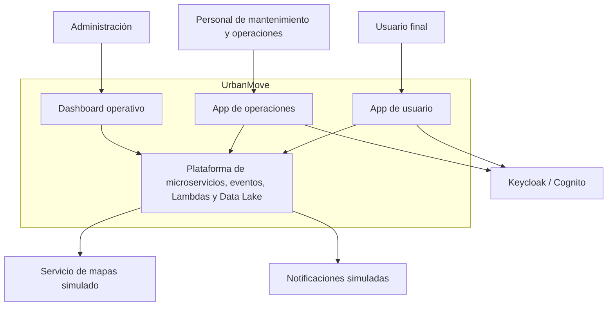
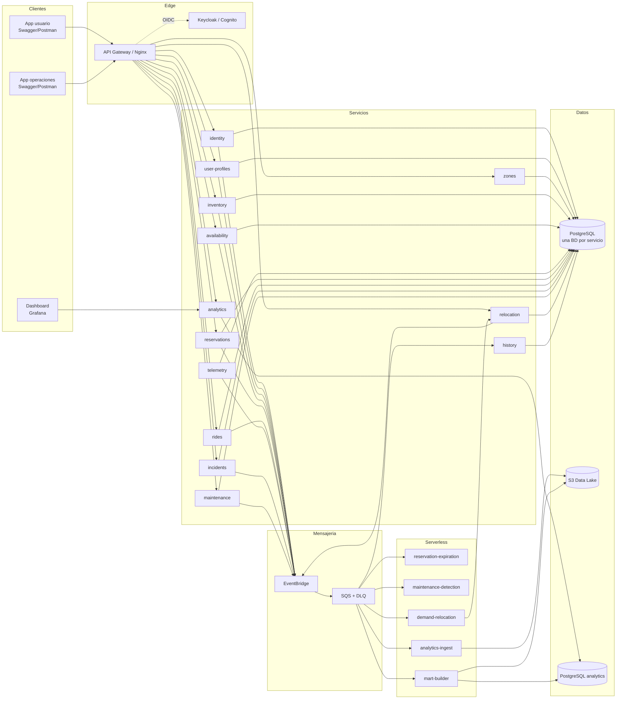
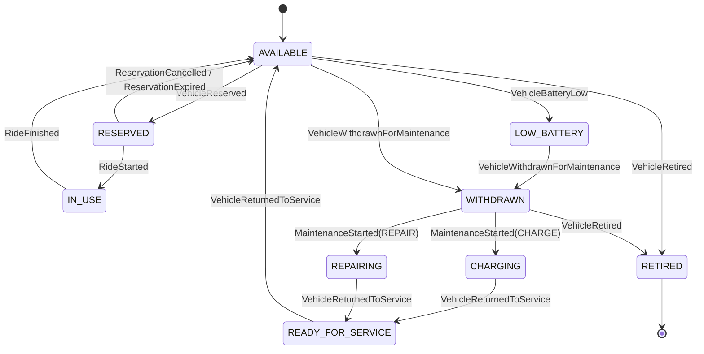

# Arquitectura de UrbanMove

> Documento técnico de referencia. El plan, el roadmap y el reparto están en
> [`PLAN.md`](../00-gestion/PLAN.md). El orden de implementación y las dependencias
> entre servicios están en [`SERVICE-ROADMAP.md`](SERVICE-ROADMAP.md). El detalle de
> almacenamiento, eventos e inmutabilidad está en
> [`DATA-ARCHITECTURE.md`](DATA-ARCHITECTURE.md); la separación entre carga
> transaccional y analítica, en [`OLTP-OLAP.md`](OLTP-OLAP.md).

---

## 1. Principios

1. **Microservicios atómicos:** una responsabilidad principal, una API clara, una base
   de datos propia y despliegue independiente.
2. **Bajo acoplamiento:** REST solo para consultas que necesitan respuesta inmediata;
   todo lo demás, eventos.
3. **Contratos primero:** OpenAPI para REST y JSON Schema/AsyncAPI para eventos antes
   de implementar.
4. **Datos propios:** ningún servicio lee la base de datos de otro.
5. **Inmutabilidad y Java moderno:** records, sealed interfaces, colecciones
   inmutables y servicios stateless.
6. **Fallo parcial, no fallo total:** colas, reintentos, DLQ, idempotencia y
   degradación funcional.
7. **Reproducibilidad:** Docker Compose en local, Terraform para infraestructura,
   GitHub Actions para CI/CD.
8. **Cero secretos en el repositorio.**

---

## 2. Vista de contexto (C4)



**Actores:** usuario final, mantenimiento/operaciones y administración.

**Sistemas externos simulados:** mapas/geolocalización y notificaciones. Se representan
con interfaces simples para no depender de proveedores reales.

---

## 3. Vista de contenedores



### 3.1. Responsabilidades de infraestructura

| Componente | Responsabilidad |
|---|---|
| API Gateway / Nginx | Punto de entrada, TLS, rate limit, CORS, validación de JWT |
| Keycloak / Cognito | Login, tokens, roles |
| PostgreSQL operacional | Datos transaccionales, una base de datos por servicio (12 bases) + `keycloak_db` |
| PostgreSQL analítico | Data marts para el dashboard (`analytics_db`) |
| EventBridge | Bus de eventos de dominio |
| SQS + DLQ | Desacoplo, buffer, reintentos y mensajes fallidos |
| Lambda | Expiración, detección, ingesta, marts y recolocación |
| S3 | Data Lake raw/trusted/curated |
| Grafana | Dashboard operativo y paneles técnicos |
| Prometheus | Métricas de los servicios |

---

## 4. Comunicación

### 4.1. Síncrona (REST)

Se usa solo cuando el usuario necesita respuesta inmediata:

- Consultar zonas y recursos disponibles.
- Crear una reserva.
- Iniciar o finalizar un viaje.
- Consultar historial o analítica.

Reglas:

- Timeouts explícitos.
- Circuit breaker y retry con Resilience4j en llamadas a otros servicios.
- Nunca encadenar llamadas síncronas largas.
- Si un servicio no crítico falla, degradar la funcionalidad.

### 4.2. Asíncrona (eventos)

Se usa para todo lo que puede procesarse después:

- Historial.
- Data Lake e ingesta analítica.
- Data marts.
- Notificaciones.
- Detección de mantenimiento.
- Recolocación.

Ventajas: desacoplo, buffer ante picos, reintentos, DLQ y capacidad de reproducción.

### 4.3. Patrón outbox

Cada servicio con estado guarda el evento en `outbox_event` dentro de la misma
transacción que el cambio de negocio. Un relay lo publica y lo marca como enviado.
Así no se pierde un evento si el bus está caído.

---

## 5. Catálogo de servicios y contratos

| Servicio | API principal | Eventos que publica | Eventos que consume |
|---|---|---|---|
| `identity` | `/auth`, `/users`, `/roles` | `UserRegistered` | — |
| `user-profiles` | `/profiles` | `UserProfileUpdated` | `UserRegistered` |
| `zones` | `/zones` | `ZoneCreated` | — |
| `inventory` | `/vehicles`, `/acquisitions` | `VehiclePurchased`, `VehicleRetired` | — |
| `availability` | `/availability` | `VehicleBecameAvailable`, `VehicleBecameUnavailable` | `VehicleReserved`, `RideStarted`, `RideFinished`, `VehicleBatteryLow`, `VehicleWithdrawnForMaintenance`, `VehicleReturnedToService` |
| `telemetry` | `/telemetry` | `VehicleTelemetryReceived` | — |
| `reservations` | `/reservations` | `VehicleReserved`, `ReservationCancelled`, `ReservationExpired` | `RideStarted`, `RideFinished` |
| `rides` | `/rides` | `RideStarted`, `RideFinished` | `VehicleReserved` |
| `incidents` | `/incidents` | `IncidentReported` | — |
| `maintenance` | `/maintenance-orders` | `VehicleWithdrawnForMaintenance`, `VehicleReturnedToService`, `MaintenanceOrderCreated`, `MaintenanceOrderCompleted` | `VehicleBatteryLow`, `IncidentReported` |
| `relocation` | `/relocation-orders` | `RelocationOrderCreated`, `RelocationOrderCompleted` | `DemandHotspotDetected` |
| `history` | `/history` | — | Todos los eventos |
| `analytics` | `/analytics` | — | — (lee marts) |

> Los nombres exactos de endpoints y payloads se fijan en `contracts/openapi/` antes de
> implementar cada servicio.

Las convenciones de implementación (nomenclatura, estructura de paquetes, reglas de
dependencia) están en [CODE-STANDARDS.md](../02-desarrollo/CODE-STANDARDS.md); la estrategia de pruebas en
[TESTING.md](../02-desarrollo/TESTING.md) y el empaquetado en [CONTAINERS.md](../02-desarrollo/CONTAINERS.md).

---

## 6. Propiedad de datos

| Entidad | Propietario | Clave |
|---|---|---|
| `user_account` | `identity` | `user_id`, `subject_id` |
| `role_assignment` | `identity` | `user_id`, `role` |
| `user_profile` | `user-profiles` | `user_id` |
| `zone` | `zones` | `zone_id` |
| `vehicle_asset` | `inventory` | `vehicle_id` |
| `vehicle_availability` | `availability` | `vehicle_id`, `version` |
| `telemetry_reading` | `telemetry` | `reading_id`, `vehicle_id` |
| `reservation` | `reservations` | `reservation_id` |
| `reservation_attempt` | `reservations` | `attempt_id` |
| `ride` | `rides` | `ride_id` |
| `incident` | `incidents` | `incident_id` |
| `maintenance_order` | `maintenance` | `order_id` |
| `relocation_order` | `relocation` | `order_id` |
| `history_entry` | `history` | `entry_id`, `event_id` |
| `mart_*` | `analytics` | según mart |

**Regla de oro:** la base de datos de un servicio es privada. Los demás solo ven APIs o
eventos.

---

## 7. Estados

El estado operativo lo posee `availability`. Los demás servicios publican eventos y
`availability` valida la transición.



### 7.1. Reglas de negocio

- Un recurso no puede tener dos reservas activas.
- Una reserva no confirmada expira y libera el recurso.
- Un viaje solo empieza sobre un recurso reservado o disponible.
- Al finalizar un viaje, el recurso vuelve a `AVAILABLE` o pasa a `LOW_BATTERY` si la
  telemetría lo indica.
- Un recurso `WITHDRAWN` no puede reservarse.
- Un recurso `RETIRED` no puede reactivarse.

---

## 8. Data Lake

### 8.1. Capas

| Capa | Contenido | Formato |
|---|---|---|
| `raw` | Evento tal cual llega | JSON/JSONL |
| `trusted` | Validado, deduplicado, normalizado | Parquet |
| `curated` | Agregados y marts | Parquet |

### 8.2. Particiones

```text
raw/source=<servicio>/event_type=<Evento>/year=YYYY/month=MM/day=DD/hour=HH/
trusted/event_type=<Evento>/year=YYYY/month=MM/day=DD/
curated/domain=<dominio>/year=YYYY/month=MM/day=DD/
```

### 8.3. Reprocesamiento (Kappa)

El log de eventos es la fuente de verdad. Para reconstruir un mart:

1. Se lee raw desde la ventana temporal deseada.
2. Se deduplica por `eventId`.
3. Se reconstruye trusted.
4. Se recalculan los agregados de curated.
5. Se actualiza el mart.

No se necesita una capa batch separada; el batch es una reproducción del log.

---

## 9. Data marts y analítica

| Mart | Grano | Uso |
|---|---|---|
| `mart_usuarios` | usuario / día | Usuarios activos, viajes, cancelaciones |
| `mart_reservas` | zona / hora / tipo | Reservas, expiraciones, conversión |
| `mart_viajes` | origen-destino / hora / tipo | Demanda, duración, coste preliminar |
| `mart_flota` | zona / tipo / hora | Disponibles, reservados, en uso, carga, reparación |
| `mart_mantenimiento` | recurso / día | Batería, reparaciones, tiempo fuera de servicio |
| `mart_operaciones` | zona / día | Órdenes de recolocación y retraso |
| `mart_demanda` | zona / hora / tipo | Déficit/exceso y descuadre de flota |

### 9.1. Decisión operacional

La Lambda `demand-relocation` evalúa `mart_demanda` cada 5 minutos y aplica la regla del
enunciado. La orden se publica y `relocation` la persiste. La app de operaciones la
consulta y la completa.

---

## 10. Despliegue

### 10.1. Local (por defecto)

- Docker Compose.
- Un contenedor PostgreSQL con las 14 bases (equivalente al plan B de AWS).
- LocalStack, Keycloak, Grafana y Prometheus.
- Servicios Spring Boot con perfil `local`.
- Lambdas ejecutadas contra LocalStack.
- CI con los mismos contenedores.

### 10.2. AWS Academy (si hay cuenta)

- Una EC2 con Docker Compose para los servicios.
- S3, SQS, EventBridge, Lambda y CloudWatch reales.
- Keycloak en la EC2 o Cognito.
- **Dos instancias RDS** (operacional y analítica) como objetivo. Si la cuenta o el
  crédito no lo permiten, una sola instancia con las 14 bases o PostgreSQL en la EC2.
- Recursos creados con Terraform cuando sea posible.

### 10.3. AWS real (opcional)

- ECS Fargate + ALB para los servicios críticos.
- RDS PostgreSQL operacional con Multi-AZ.
- RDS PostgreSQL analítico (instancia menor, réplica de lectura opcional).
- S3 + SQS + EventBridge + Lambda.
- ECR para imágenes.
- CloudWatch + X-Ray.
- OIDC para GitHub Actions.
- Budgets y limpieza obligatoria.

> EKS, MSK y Redshift quedan fuera del alcance por coste y complejidad.

---

## 11. Seguridad

- OIDC Authorization Code + PKCE.
- JWT validado en cada servicio.
- Roles `USER`, `MAINTENANCE`, `ADMIN`.
- `identity` como fachada de administración; el IdP gestiona credenciales y sesiones.
- Secretos en `.env` (local) o Secrets Manager/SSM (AWS).
- GitHub Actions con OIDC; sin claves de larga duración.
- Contenedores no-root.
- Validación de entrada, CORS y rate limiting.
- Escaneo de dependencias, imágenes y secretos.
- Logs sin tokens ni contraseñas.

---

## 12. Tolerancia a fallos

| Fallo | Comportamiento esperado |
|---|---|
| `history` caído | El viaje termina; los eventos se acumulan en SQS y se procesan al volver |
| Lambda de marts falla | Los eventos quedan en raw/DLQ; se reprocesan y el mart se reconstruye |
| Evento duplicado | La tabla de idempotencia evita el doble procesamiento |
| Reserva no confirmada | La Lambda de expiración la libera |
| Servicio de notificaciones caído | El flujo principal continúa; la notificación se reintenta |
| Base de datos lenta | Timeouts, pool limitado y circuit breaker |

---

## 13. Escalabilidad

- Servicios stateless y escalables horizontalmente.
- SQS como buffer ante picos.
- Lambdas en paralelo.
- Lake particionado.
- Marts incrementales.
- Analítica separada de la operación mediante **dos instancias RDS** (operacional y
  analítica).
- Cuellos de botella identificados: escrituras en reservas/disponibilidad y consultas
  analíticas. Mitigaciones: bloqueo optimista, índices, caché, réplicas de lectura y
  preagregación.
- Camino de escalado: separar `telemetry_db` a su propia instancia, añadir réplica de
  lectura para analítica y particionar tablas históricas.

---

## 14. Observabilidad

- Logs JSON con `correlationId`, `eventId` y servicio.
- Métricas Micrometer:
  - reservas creadas, canceladas y expiradas;
  - viajes iniciados y finalizados;
  - recursos disponibles por estado;
  - órdenes de mantenimiento y recolocación;
  - eventos publicados/consumidos y DLQ;
  - latencia y errores HTTP.
- Prometheus + Grafana.
- Actuator health/liveness/readiness.
- CloudWatch en AWS.

---

## 15. Decisiones pendientes

- ¿AWS Academy o cuenta real? Se decide cuando haya respuesta.
- ¿Keycloak o Cognito en el despliegue AWS? Keycloak local; Cognito si hay cuenta.
- ¿UI web propia o Swagger/Postman + Grafana? Se empieza por lo segundo.
- ¿DynamoDB para telemetría? Solo si se quiere la ampliación; no es camino crítico.
- ¿Terraform para LocalStack desde el inicio o tras la Fase 1? Se recomienda desde la
  Fase 0 para no acumular deuda.

**Decidido:** dos instancias RDS PostgreSQL (operacional y analítica), con plan B de una
sola instancia si AWS o el crédito lo impiden. Ver
[`DATA-ARCHITECTURE.md`](DATA-ARCHITECTURE.md) y el
[ADR 0006](adr/0006-dos-instancias-rds.md).
