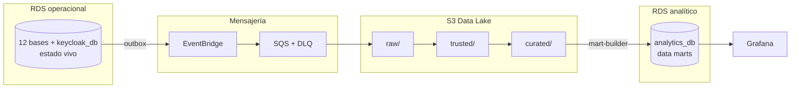
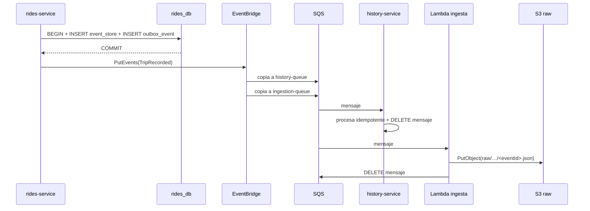

# Arquitectura de datos de UrbanMove

> **Estado:** propuesta para revisión del equipo.
> **Última actualización:** 2026-11-11.
> **Ámbito:** almacenamiento operacional, Data Lake, eventos, data marts, inmutabilidad,
> escalabilidad y tolerancia a fallos.
> **Decisiones relacionadas:** [ADR 0002](adr/0002-postgresql-vs-dynamodb.md) (PostgreSQL),
> [ADR 0003](adr/0003-kappa-medallion.md) (Kappa + Medallón),
> [ADR 0006](adr/0006-dos-instancias-rds.md) (dos instancias RDS),
> [ADR 0007](adr/0007-event-sourcing-raw-trusted-curated.md) (event sourcing inmutable).
> **Cargas:** el detalle de OLTP frente a OLAP está en [`OLTP-OLAP.md`](OLTP-OLAP.md) y
> la clasificación por servicio en
> [`SERVICE-CLASSIFICATION.md`](SERVICE-CLASSIFICATION.md).
> **Modelo y eventos:** relaciones en [`DATA-MODEL.md`](DATA-MODEL.md), atributos en
> [`DATA-DICTIONARY.md`](DATA-DICTIONARY.md) y event sourcing en
> [`EVENT-SOURCING.md`](EVENT-SOURCING.md).

---

## 0. Decisión principal (resumen)

1. **Dos instancias RDS PostgreSQL en AWS**:
   - `urbanmove-operational`: las **12 bases de datos de servicio**, una por
     microservicio de negocio, más `keycloak_db` (base de infraestructura del IdP).
   - `urbanmove-analytics`: **una base** (`analytics_db`) con los data marts que
     consume Grafana.
2. **Un único bucket S3** (`urbanmove-datalake`) con tres prefijos: `raw/`, `trusted/`
   y `curated/`.
3. **Plan B asumido desde el principio**: si la integración en AWS o el crédito se
   complican, se colapsa a **una sola instancia RDS con las 14 bases**. El código no
   cambia; solo cambia configuración. Los detalles están en la sección 13.

> **Importante:** este documento **no descarta** la opción de una sola instancia.
> La arquitectura se diseña para dos porque separa la carga analítica de la operativa,
> que es el cuello de botella identificado. La opción de una instancia se mantiene como
> **camino de repliegue oficial**, no como fracaso: es la misma arquitectura lógica con
> otro empaquetado físico.

### 0.1. Lo que nunca se hace

| Prohibido | Motivo |
|---|---|
| Compartir una base de datos entre dos servicios | Rompe la propiedad de datos y el despliegue independiente |
| Analizar directamente sobre la base operacional | Las consultas de Grafana compiten con reservas y viajes |
| Usar S3 como base de datos operacional | Sin transacciones, sin restricciones, sin consultas por campo |
| Usar DynamoDB en el núcleo | Modelo de acceso rígido y segundo paradigma innecesario |
| Actualizar un mart con `valor = valor + 1` como fuente de verdad | No es idempotente ni reproducible |
| Guardar secretos en el repositorio | El repositorio es público |

---

## 1. Glosario

| Término | Significado en este proyecto |
|---|---|
| **Evento** | Hecho ocurrido e inmutable, por ejemplo `VehiclePickedUp` |
| **Mensaje** | El evento empaquetado mientras viaja por EventBridge o SQS |
| **Outbox** | Tabla del servicio donde se guarda la intención de publicar, en la misma transacción que el evento |
| **Event store** | Log append-only que **es la verdad** del agregado; permite reconstruir el estado del servicio |
| **Proyección** | Tabla derivada del event store, append-only por versión; la vista `*_current` da el estado actual |
| **Snapshot** | Foto opcional y desechable del estado de un agregado; nunca sustituye al event store |
| **Data Lake** | Archivo histórico de eventos en S3, organizado en capas |
| **Data mart** | Tabla agregada y consultable, orientada a una pregunta de negocio |
| **RDS** | Servicio gestionado de AWS que alquila instancias de PostgreSQL (no es "una base de datos") |
| **Prefijo** | Ruta dentro de un bucket S3 (`raw/`, `trusted/`). No confundir con *tags* |
| **DLQ** | *Dead Letter Queue*: cola donde acaban los mensajes que fallan repetidamente |

---

## 2. Tres almacenes, tres trabajos



| Almacén | Contenido | Pregunta que responde | Mutabilidad |
|---|---|---|---|
| RDS operacional | Event store + proyecciones | "¿Está libre la bici 42?" | Event store append-only; proyecciones append-only por versión |
| S3 Data Lake | Histórico completo de eventos | "¿Qué pasó el martes a las 18h?" | Inmutable |
| RDS analítico | Agregados para el dashboard | "¿Cuántos viajes por zona?" | Marts append-only por `build_id` |

**Idea clave:** el evento no "se mueve" de un sitio a otro. Se **copia** en formas
distintas, cada una con un propósito. El mismo `VehiclePickedUp` existe a la vez como
fila en `event_store`, como mensaje en SQS y como fichero en S3.

---

## 3. Por qué PostgreSQL, por qué no DynamoDB y por qué S3 no es una base de datos

### 3.1. Comparativa

| | PostgreSQL | DynamoDB | S3 |
|---|---|---|---|
| Tipo | Relacional | NoSQL clave-valor/documento | Almacenamiento de objetos |
| Transacciones | Sí, completas | Limitadas (hasta 100 ítems) | No |
| Restricciones únicas | Sí (`UNIQUE`, índices parciales) | Condicionales, manuales | No |
| Consultas ad-hoc | Sí (`JOIN`, `GROUP BY`) | Solo por clave e índices predefinidos | No; requiere un motor encima |
| Modificar un campo | Sí | Sí | No; se reescribe el objeto |
| Escala de escritura | Alta con tuning | Muy alta, horizontal | Muy alta, automática |
| Coste | Por instancia/hora | Por petición | Por GB y petición |
| Papel en UrbanMove | Operación y marts | Ampliación opcional | Data Lake |

### 3.2. Por qué PostgreSQL en el núcleo

1. **Doble reserva:** se evita con una restricción única, no con lógica distribuida.
2. **Data marts:** `GROUP BY` y `JOIN` son consultas naturales, no precomputaciones.
3. **Coste de equipo:** un solo paradigma para todo el equipo.
4. **Ecosistema:** Spring Data JPA, Flyway y Testcontainers están probados.

### 3.3. Por qué S3 no puede ser la base operacional

- No hay transacciones ni bloqueos: dos usuarios podrían reservar la misma bici.
- No se puede preguntar "¿está libre la bici 42?" sin leer y filtrar objetos.
- No se puede modificar un campo: se reescribe el objeto completo.
- Listar es lento y limitado; no es un motor de consulta.

### 3.4. Cuándo sí DynamoDB

Solo como **ampliación opcional**:

- Telemetría con miles de escrituras por segundo.
- Read-model de disponibilidad de latencia ultrabaja.

Nunca para reservas, viajes, historial ni marts. Justificación completa en el
[ADR 0002](adr/0002-postgresql-vs-dynamodb.md).

### 3.5. Local y AWS: mismo motor, distinto anfitrión

La decisión **no es "PostgreSQL en local y otra cosa en la nube"**. El motor operacional
es el mismo en los dos entornos; solo cambia quién lo aloja y cómo se aprovisiona.

| Entorno | Datos operacionales | Data Lake | DynamoDB |
|---|---|---|---|
| **Local** | Un contenedor `postgres:16` con las 14 bases | LocalStack (S3 emulado) | No se usa; si se probara, LocalStack |
| **AWS Academy** | RDS PostgreSQL: dos instancias o plan B de una | S3 real | Solo ampliación opcional de telemetría |
| **AWS real (opcional)** | RDS Multi-AZ | S3 real | Solo ampliación opcional de telemetría |

Consecuencia práctica: el código no cambia entre local y AWS. Solo cambia la
configuración de conexión (`DB_HOST`, `DB_PORT`, `DB_NAME`). Por eso la decisión se
toma una vez y vale para los dos entornos.

Lo que sí es una decisión de nube es **dónde se aloja PostgreSQL** (ADR 0006: dos
instancias RDS con plan B de una) y **cuándo se despliega** (ADR 0001: local primero,
AWS después). La comparación PostgreSQL frente a DynamoDB es una decisión de **motor**,
no de entorno.

---

## 4. Parquet: qué es y por qué se usa en el lago

**Parquet** es un formato **columnar** y binario. Guarda cada columna de forma contigua,
comprimida y con estadísticas por bloque.

| | JSON (por filas) | Parquet (por columnas) |
|---|---|---|
| Lectura de una columna | Hay que parsear la fila entera | Lee solo esa columna |
| Compresión | Baja | Alta (Snappy/Zstd) |
| Estadísticas para saltar ficheros | No | Sí (mín/máx por bloque) |
| Esquema | Implícito o externo | Embebido |
| Legible por humanos | Sí | No (binario) |
| Herramientas | Cualquiera | Athena, Spark, DuckDB, pandas, Trino |

### 4.1. Reparto por capas

| Capa | Formato | Motivo |
|---|---|---|
| `raw` | JSON | Auditar exactamente qué llegó; depuración |
| `trusted` | Parquet | Validado, deduplicado y comprimido |
| `curated` | Parquet | Agregados; es lo que más se lee |

**Regla:** JSON para entender, Parquet para analizar. No se convierte `raw` a Parquet:
`raw` debe conservar el original tal cual.

---

## 5. S3: el Data Lake

### 5.1. Un bucket, tres prefijos

```text
s3://urbanmove-datalake/
├── raw/
├── trusted/
└── curated/
```

Los nombres `raw/`, `trusted/` y `curated/` son **prefijos de clave** (rutas), no
*tags*. Los *tags* de S3 son etiquetas de objeto para coste y clasificación, y no se
usan para separar capas.

Un solo bucket es suficiente porque los prefijos permiten:

- **IAM por prefijo:** la Lambda de ingesta solo escribe en `raw/*`.
- **Lifecycle por prefijo:** `raw` se retiene más; `trusted` y `curated` se regeneran.
- **Consultas con particiones** que evitan leer ficheros innecesarios.

Se separaría en varios buckets solo por región distinta, dueño distinto, requisito legal
distinto o aislamiento de borrado. No es el caso del proyecto.

### 5.2. Particionado

```text
raw/source=<servicio>/event_type=<Evento>/year=YYYY/month=MM/day=DD/hour=HH/<eventId>.json
trusted/event_type=<Evento>/year=YYYY/month=MM/day=DD/
curated/domain=<dominio>/year=YYYY/month=MM/day=DD/
```

Reglas:

- El nombre del objeto deriva del `eventId`, así que **nunca se sobrescribe** un evento
  distinto.
- `raw` conserva el JSON original, sin transformar.
- `trusted` deduplica por `eventId` y normaliza.
- `curated` contiene agregados por dominio (`demand`, `fleet`, `maintenance`…).

### 5.3. Inmutabilidad por diseño

- Cada evento es un objeto nuevo con clave única.
- No existe operación de `UPDATE` sobre un objeto: se escribe o se lee.
- Si el mismo evento se reprocesa, se escribe la misma clave con el mismo contenido.

### 5.4. Inmutabilidad impuesta por AWS

| Medida | Qué garantiza |
|---|---|
| **S3 Versioning** | Cada escritura crea una versión; nada se pierde |
| **S3 Object Lock (WORM)** | Bloquea borrado y sobrescritura durante la retención |
| **Bucket policy** | Deniega `s3:DeleteObject` y `s3:DeleteObjectVersion` en `raw/*` |
| **IAM de mínimo privilegio** | La ingesta solo puede `PutObject` en `raw/*` |
| **SSE-KMS** | Cifrado en reposo con clave gestionada |
| **CloudTrail con data events** | Auditoría de acceso a objetos |

Ejemplo de política de protección de `raw`:

```json
{
  "Version": "2012-10-17",
  "Statement": [
    {
      "Sid": "DenyDeleteRaw",
      "Effect": "Deny",
      "Principal": "*",
      "Action": ["s3:DeleteObject", "s3:DeleteObjectVersion"],
      "Resource": "arn:aws:s3:::urbanmove-datalake/raw/*"
    }
  ]
}
```

Modos de Object Lock:

- `GOVERNANCE`: un usuario con permiso especial puede saltárselo (útil en desarrollo).
- `COMPLIANCE`: **nadie** puede borrar hasta que expire la retención (útil para la demo
  de inmutabilidad).

> En LocalStack, Versioning funciona y Object Lock está soportado parcialmente.
> Documentar qué se probó en local y qué se probó en AWS.

### 5.5. Ciclo de vida

| Prefijo | Retención orientativa | Justificación |
|---|---|---|
| `raw/` | 2 años (o indefinida con Object Lock) | Fuente de reprocesamiento |
| `trusted/` | 1 año | Regenerable desde `raw` |
| `curated/` | 6 meses | Regenerable desde `trusted` |

---

## 6. RDS: topología objetivo y plan B

### 6.1. Qué es RDS

RDS (**Relational Database Service**) es el servicio de AWS que alquila instancias de
PostgreSQL gestionadas: backups, parcheo, failover y réplicas. **No es una base de
datos**: es el servicio. Dentro de una instancia viven varias bases de datos.

### 6.2. Topología objetivo: dos instancias

```text
AWS
├── RDS "urbanmove-operational"          ── Multi-AZ, backups, PITR
│     ├── identity_db
│     ├── profiles_db
│     ├── zones_db
│     ├── inventory_db
│     ├── availability_db
│     ├── telemetry_db
│     ├── reservations_db
│     ├── rides_db
│     ├── incidents_db
│     ├── maintenance_db
│     ├── relocation_db
│     ├── history_db
│     └── keycloak_db            (infraestructura, no es de un microservicio)
│
└── RDS "urbanmove-analytics"            ── instancia más pequeña
      └── analytics_db
            ├── mart_usuarios
            ├── mart_reservas
            ├── mart_viajes
            ├── mart_flota
            ├── mart_mantenimiento
            ├── mart_operaciones
            └── mart_demanda
```

Total: **12 bases de servicio + 1 base de infraestructura (`keycloak_db`) + 1 base
analítica = 14 bases**.

#### Por qué separar

| Motivo | Efecto |
|---|---|
| Aislamiento de carga | Un `GROUP BY` de Grafana no compite con las reservas |
| Escalado independiente | La analítica puede usar una instancia más pequeña o más grande |
| Seguridad | Grafana solo tiene acceso a `analytics_db`, nunca a `rides_db` |
| Fallo contenido | Si la analítica se satura, la operación sigue |
| Coste | La instancia analítica puede ser de menor tamaño |

#### Reglas de red y acceso

- La instancia operacional solo acepta conexiones de los microservicios.
- La instancia analítica solo acepta conexiones de:
  - el servicio `analytics`,
  - la Lambda `mart-builder`,
  - Grafana (solo lectura).
- Cada base tiene su **usuario propio**; no existe un usuario compartido entre dominios.
- `public` sin privilegios por defecto.

```sql
CREATE DATABASE reservations_db;
CREATE ROLE reservations_svc LOGIN PASSWORD :'pwd';
GRANT CONNECT ON DATABASE reservations_db TO reservations_svc;

\connect reservations_db
REVOKE ALL ON SCHEMA public FROM PUBLIC;
GRANT USAGE, CREATE ON SCHEMA public TO reservations_svc;
```

### 6.3. Plan B: una sola instancia

```text
RDS "urbanmove"  ── 14 bases
    ├── identity_db … history_db
    ├── keycloak_db
    └── analytics_db
```

Es la **misma arquitectura lógica**, con menos aislamiento físico. Se adopta si:

- AWS Academy no permite crear dos instancias RDS.
- El crédito no da para dos instancias encendidas durante la Demo.
- Terraform o la red de la cuenta complican la segunda instancia.

No cambia ninguna línea de código: cada servicio sigue apuntando a su base por
configuración (`DB_HOST`, `DB_NAME`). Cambiar de una a dos instancias es cambiar
`DB_HOST` en `analytics` y en `mart-builder`, nada más.

### 6.4. En local

Un único contenedor `postgres:16` con las 14 bases. Es el equivalente al plan B, y
sigue siendo una arquitectura correcta: la separación lógica se mantiene.

El script de inicialización crea las bases y los usuarios. Los servicios no saben si
están en una instancia o en dos.

### 6.5. Conexiones

- 12 servicios × pool pequeño (5-10 conexiones) puede agotar una instancia pequeña.
- Usar pools reducidos por servicio y, si hace falta, **PgBouncer**.
- La Lambda `mart-builder` usa una conexión corta y cierra.
- Nunca compartir un pool entre servicios.

---

## 7. El ciclo de vida de un evento

### 7.1. Traza completa: `TripRecorded` a las 18:30

| Momento | Dónde vive | Forma física | Duración |
|---|---|---|---|
| 18:30:00.100 | RDS `rides_db.event_store` | Fila | Permanente (append-only) |
| 18:30:00.100 | RDS `rides_db.outbox_event` | Fila | Permanente (append-only) |
| 18:30:00.400 | EventBridge | Mensaje gestionado | Milisegundos |
| 18:30:00.600 | SQS `history-queue` | Mensaje en cola | Hasta 14 días |
| 18:30:00.650 | SQS `ingestion-queue` → Lambda | Mensaje en cola | Hasta 14 días |
| 18:30:01.000 | `history-service` | Objeto en memoria | Milisegundos |
| 18:30:02.000 | S3 `raw/…/<eventId>.json` | Fichero | Permanente |
| Fallo tras N intentos | SQS DLQ | Mensaje | Hasta 14 días |



El pickup y el dropoff recorren el mismo camino como `VehiclePickedUp` y
`VehicleDroppedOff`; el `TripRecorded` se añade cuando `rides` los correlaciona.

### 7.2. Los cuatro registros del mismo evento

| Sitio | Papel | Por qué no se puede sustituir |
|---|---|---|
| `event_store` (RDS) | Verdad del agregado | Guarda la versión y permite reconstruir el estado |
| `outbox_event` (RDS) | Intención de publicar | Necesita atomicidad con la escritura del evento |
| EventBridge + SQS | Transporte | S3 no hace push, no reintenta ni hace fan-out |
| S3 `raw/` | Archivo analítico | La BD operacional no debe servir analítica ni guardar años de historia |

**Decisión del proyecto (ADR 0007):** `event_store` y `outbox_event` son append-only.
Publicar **no** actualiza nada: se inserta una fila en `event_publication`. Así el
diseño no depende de un `UPDATE` para saber qué se publicó.

### 7.3. EventBridge vs SQS

| | EventBridge | SQS |
|---|---|---|
| Función | Router de eventos | Cola de un consumidor |
| Entrega | Fan-out según reglas | Punto a punto |
| Filtrado por contenido | Sí | No |
| Buffer si el consumidor cae | No | Sí (hasta 14 días) |
| Reintentos con backoff | No | Sí (visibility timeout) |
| DLQ | No directamente | Sí, nativa |
| Archive & Replay | Sí | No |
| Orden | No garantizado | Estándar no; FIFO sí |

Se usan **juntos**: el servicio publica en EventBridge, una regla enruta a la cola SQS
de cada consumidor, y cada consumidor procesa a su ritmo.

**SNS** queda descartado: pub/sub simple sin filtrado rico ni replay. EventBridge cubre
más y es lo que se evalúa.

### 7.4. Reintentos y DLQ

- SQS reintenta con *visibility timeout*.
- Tras `maxReceiveCount` (por ejemplo 3), el mensaje va a la DLQ.
- Una alarma avisa cuando la DLQ tiene mensajes.
- El reprocesamiento es manual o con una herramienta de replay.
- EventBridge Archive permite reproducir eventos para reconstruir el lago (Kappa).

---

## 8. Inmutabilidad y proyecciones

### 8.1. Log append-only

```sql
CREATE TABLE event_store (
  global_position   BIGSERIAL PRIMARY KEY,
  event_id          UUID        NOT NULL UNIQUE,
  aggregate_type    TEXT        NOT NULL,
  aggregate_id      UUID        NOT NULL,
  aggregate_version INT         NOT NULL,
  event_type        TEXT        NOT NULL,
  event_version     INT         NOT NULL,
  schema_uri        TEXT,
  occurred_at       TIMESTAMPTZ NOT NULL,
  recorded_at       TIMESTAMPTZ NOT NULL DEFAULT now(),
  correlation_id    UUID,
  causation_id      UUID,
  actor_id          UUID,
  payload           JSONB       NOT NULL,
  metadata          JSONB       NOT NULL DEFAULT '{}',
  UNIQUE (aggregate_id, aggregate_version)
);
-- Sin UPDATE y sin DELETE de negocio.
```

La publicación se registra aparte, también sin `UPDATE`:

```sql
CREATE TABLE outbox_event (
  event_id    UUID PRIMARY KEY REFERENCES event_store(event_id),
  destination TEXT NOT NULL,
  created_at  TIMESTAMPTZ NOT NULL DEFAULT now()
);

CREATE TABLE event_publication (
  publication_id UUID PRIMARY KEY,
  event_id       UUID NOT NULL,
  destination    TEXT NOT NULL,
  published_at   TIMESTAMPTZ NOT NULL DEFAULT now(),
  UNIQUE (event_id, destination)
);
```

### 8.2. Proyecciones reconstruibles

```text
event_store (verdad, append-only)
      │
      │ fold por global_position
      ▼
trip                      ← versión 1, 2, 3…
vehicle_availability
      │
      │ vista *_current
      ▼
trip_current / vehicle_availability_current   ← estado actual
```

Cada proyección es append-only por versión:

```sql
CREATE TABLE vehicle_availability (
  projection_id  UUID PRIMARY KEY,
  vehicle_id     UUID NOT NULL,
  version        INT  NOT NULL,
  state          TEXT NOT NULL,
  zone_id        UUID,
  reservation_id UUID,
  trip_id        UUID,
  battery_pct    INT,
  valid_from     TIMESTAMPTZ NOT NULL,
  UNIQUE (vehicle_id, version)
);

CREATE VIEW vehicle_availability_current AS
SELECT DISTINCT ON (vehicle_id) *
FROM vehicle_availability
ORDER BY vehicle_id, version DESC;
```

Reconstruir:

```sql
TRUNCATE vehicle_availability;
-- replay del event_store aplicando el fold
```

### 8.3. El test de la inmutabilidad

> **¿Puedo borrar esta tabla y reconstruirla solo con eventos?**
>
> - **Sí** → es una proyección o un mart. Se puede truncar y regenerar.
> - **No** → es fuente de verdad. Debe ser el `event_store`.

Ninguna tabla de negocio se actualiza fila a fila: cada cambio es una versión nueva.

### 8.4. Por qué no `valor = valor + 1`

| Problema | Consecuencia |
|---|---|
| No es idempotente | Un evento duplicado infla el contador |
| No es reproducible | Si se pierde la tabla, el número no se puede recuperar |
| No es auditable | No se sabe de qué eventos sale el valor |
| Rompe Kappa | El replay produce resultados distintos |

Formas aceptables:

1. **Recalcular** el agregado desde los eventos (`count(*)`, `GROUP BY`).
2. **Build append-only**: cada ejecución crea un `build_id` nuevo con sus filas; la
   vista `*_current` lee el último build correcto.

En ambos casos, borrar y reprocesar da el mismo resultado.

### 8.5. La excepción: doble reserva

La inmutabilidad pura no puede impedir por sí sola que dos usuarios reserven la misma
bici. Se resuelve con dos mecanismos del agregado, no con un `UPDATE` condicional:

1. **Stream por vehículo** en `reservations`: `vehicle-reservation-<vehicleId>`.
   `ReservationSlotHeld` y `ReservationSlotReleased` serializan las reservas de esa bici.
2. **Versión esperada** en `event_store`: si dos comandos leen la versión 7 e intentan
   escribir la 8, uno falla por `UNIQUE (aggregate_id, aggregate_version)` y se
   reintenta.

La proyección `reservation_slot_current` permite consultar el slot activo, pero el
guardián de concurrencia es la versión del agregado.

### 8.6. Los data marts son append-only

Los marts no son "inmutables por fila", pero tampoco se actualizan con `UPSERT`:

- Cada ejecución crea un `build_id` con su ventana temporal.
- Las filas del build se insertan una sola vez.
- La vista `*_current` selecciona el último build con `status = 'SUCCESS'`.
- Un build fallido se ignora; se reconstruye desde `trusted/`.

La garantía no es "no cambian", sino **"se reconstruyen sin pérdida y sin duplicar"**.
Detalle en [EVENT-SOURCING.md](EVENT-SOURCING.md), sección 12.

---

## 9. Data marts

### 9.1. Catálogo

| Mart | Grano | Pregunta | Prioridad |
|---|---|---|---|
| `mart_usuarios` | usuario / día | Usuarios activos, viajes, cancelaciones | Alta |
| `mart_reservas` | zona / hora / tipo | Reservas, expiraciones, conversión | Alta |
| `mart_viajes` | origen-destino / hora / tipo | Demanda, duración, coste preliminar | Alta |
| `mart_flota` | zona / tipo / hora | Disponibles, reservados, en uso, carga, reparación | Alta |
| `mart_mantenimiento` | recurso / día | Batería, reparaciones, tiempo fuera de servicio | Alta |
| `mart_operaciones` | zona / día | Órdenes de recolocación y retraso | Media |
| `mart_demanda` | zona / hora / tipo | Déficit/exceso por zona | Alta |

Mínimo del enunciado: 4. Objetivo: 7.

### 9.2. Quién los construye

```text
S3 trusted/ ──► Lambda mart-builder ──► analytics_db.mart_* (nuevo build_id)
                     ▲
                     │ programado o por evento
```

- Cada ejecución genera un `build_id` y su ventana temporal.
- Las filas se insertan una sola vez: **no hay `UPSERT` ni `UPDATE`**.
- La vista `mart_*_current` lee el último build con `status = 'SUCCESS'`.
- Reprocesar la misma ventana crea un build nuevo; el resultado es idéntico y
  verificable.
- Reconstrucción completa documentada para la demo de fallo.

### 9.3. Quién los lee

- **Grafana** (solo lectura) como datasource PostgreSQL.
- **Servicio `analytics`** para exponer `GET /analytics/...` si se prefiere no dar
  acceso directo a la base de datos.

Recomendación: dar a Grafana un usuario `grafana_ro` con `SELECT` únicamente sobre
`analytics_db`. Si el equipo prefiere respetar al máximo la regla de propiedad, Grafana
consume la API de `analytics` y no toca la base.

### 9.4. Regla de recolocación

La Lambda `demand-relocation` consulta `mart_demanda` cada 5 minutos:

> Si una zona tiene menos de 3 recursos disponibles y ha tenido más de 10 intentos de
> reserva o viajes iniciados en la última hora, se genera una orden para mover recursos
> desde una zona con exceso.

La orden se publica como `RelocationOrderCreated` y la app de operaciones la completa.

---

## 10. Escalabilidad

### 10.1. Por componente

| Componente | Cómo escala | Límite |
|---|---|---|
| Microservicios | Horizontal, son stateless | Ninguno relevante |
| SQS | Throughput casi ilimitado (estándar) | FIFO: por *message group* |
| Lambdas | Paralelismo automático | Límite de concurrencia de la cuenta |
| S3 | Automático, sin aprovisionar | Ninguno práctico |
| RDS operacional | Vertical + separar servicios | Un solo *writer* |
| RDS analítico | Vertical + réplica de lectura | Un solo *writer* |
| Data Lake | Particionado + Parquet | Coste de almacenamiento |

### 10.2. Camino de escalado de la base de datos

```text
Fase 1  2 instancias: operacional (12 BD de servicio + keycloak_db) + analítica (1 BD)
Fase 2  réplica de lectura para analytics si Grafana aprieta
Fase 3  separar telemetry_db a su propia instancia si hay mucha escritura
Fase 4  particionar tablas históricas y archivar a S3
```

La separación lógica en 14 bases es lo que permite este camino. Una base compartida no
lo permitiría.

### 10.3. Cuellos de botella y mitigación

| Cuello de botella | Mitigación |
|---|---|
| Escrituras concurrentes en reservas/disponibilidad | Versión esperada en `event_store`, stream `vehicle-reservation-<vehicleId>` e idempotencia |
| Consultas analíticas pesadas | Instancia separada, marts precalculados, réplica de lectura |
| Conexiones de 12 servicios | Pools pequeños, PgBouncer |
| Crecimiento del lago | Particionado, Parquet, lifecycle, reprocesamiento por ventana |
| Saturación de logs | Niveles configurables, muestreo y retención |

---

## 11. Tolerancia a fallos

| Componente | Mecanismo |
|---|---|
| RDS operacional | Multi-AZ, backups automáticos, PITR |
| RDS analítico | Backups; si cae, la operación continúa |
| S3 | Durabilidad 11 nueves, Versioning, Cross-Region Replication (opcional) |
| EventBridge | Reintentos de entrega, Archive & Replay |
| SQS | Retención 14 días, visibility timeout, DLQ |
| Microservicios | N réplicas, health checks, reinicio automático |
| Lambda | Reintentos, DLQ, idempotencia |
| Outbox | El evento no se pierde si el bus está caído |

### 11.1. Escenarios de fallo para la demo

1. **`history` caído:** el viaje termina, el mensaje espera en SQS y se procesa al
   reiniciar. Evidencia: profundidad de cola antes/después.
2. **`mart-builder` fallando:** el evento queda en `raw`/DLQ; al reprocesar se
   reconstruye el mart. Evidencia: fichero en `raw`, mensaje en DLQ, mart recuperado.
3. **Evento duplicado:** `processed_event` evita el doble procesamiento.
4. **Reserva no confirmada:** la Lambda de expiración la libera.

### 11.2. Diferencia local vs AWS

En local no hay Multi-AZ ni durabilidad real de S3. Se documenta como limitación del
entorno y se justifica que AWS lo aporta. Lo que sí se demuestra en local: outbox, SQS,
DLQ, idempotencia y reconstrucción de marts.

---

## 12. Topologías de despliegue y coste

### 12.1. Local (por defecto)

```text
Docker Compose
├── postgres:16          (14 bases)
├── localstack           (S3, SQS, EventBridge, Lambda, CloudWatch)
├── keycloak
├── prometheus
├── grafana
└── 13 microservicios
```

Coste: **0 €**. Es el entorno de desarrollo y de CI.

### 12.2. AWS Academy

```text
EC2 (Docker Compose)  ──►  servicios y Keycloak
RDS operacional       ──►  12 bases + keycloak_db
RDS analítico         ──►  analytics_db
S3 + SQS + EventBridge + Lambda + CloudWatch
```

Si el aula limita RDS o el crédito, se aplica el plan B (una instancia o PostgreSQL en
la EC2).

### 12.3. AWS real (opcional)

```text
ECS Fargate + ALB      ──►  servicios
RDS operacional        ──►  Multi-AZ
RDS analítico          ──►  instancia menor + réplica de lectura
S3 + SQS + EventBridge + Lambda
ECR + CloudWatch + X-Ray
```

### 12.4. Coste orientativo

Cifras aproximadas, a validar con la calculadora de AWS y con el crédito disponible:

| Recurso | Tamaño | Coste mensual orientativo |
|---|---|---|
| RDS operacional | `db.t4g.micro`, 20 GB | 12-20 € |
| RDS analítico | `db.t4g.micro`, 20 GB | 12-20 € |
| S3 | < 5 GB | < 1 € |
| SQS / EventBridge | Uso académico | < 1 € |
| Lambda | Uso académico | < 1 € |
| EC2 (si se usa) | `t3.small` | 15-20 € |

- Con **una sola instancia**, el coste de BD baja a la mitad.
- El *free tier* cubre una instancia `db.t4g.micro` durante 750 h al mes, no dos.
- Para una **ventana de demo de 2-3 días**, crear, demostrar y destruir: **< 20-30 €**.
- Si se dejan encendidas todo el mes, el coste se acumula; configurar **AWS Budgets**
  con alerta.

---

## 13. Plan de contingencia: de dos instancias a una

### 13.1. Disparadores

Se activa el plan B si ocurre cualquiera de estos:

- AWS Academy no permite crear dos instancias RDS.
- El crédito no cubre dos instancias durante el periodo de demo.
- La configuración de red (subredes, security groups) impide la segunda instancia.
- Terraform falla de forma repetida por límites de la cuenta.
- El tiempo aprieta y la segunda instancia retrasa la entrega.

### 13.2. Qué cambia

| Aspecto | Dos instancias | Una instancia |
|---|---|---|
| Bases de datos | 13 + 1 en servidores distintos | 14 en el mismo servidor |
| Propiedad lógica | Igual | Igual |
| Usuarios y permisos | Igual | Igual |
| Código de los servicios | Igual | Igual |
| Configuración | `DB_HOST` distinto para analytics | Mismo `DB_HOST` |
| Aislamiento de carga | Sí | No |
| Coste | Mayor | Menor |

### 13.3. Cómo migrar (sin tocar código)

```text
1. Crear analytics_db en la instancia operacional.
2. Ejecutar las migraciones de marts allí.
3. Cambiar DB_HOST de analytics y mart-builder.
4. Reiniciar esos dos componentes.
5. Verificar Grafana y la Lambda.
6. Destruir la instancia analítica.
```

El paso inverso es igual de sencillo: crear la instancia, migrar `analytics_db` con
`pg_dump`/`pg_restore`, cambiar `DB_HOST` y listo.

### 13.4. Qué se pierde y qué no

- **Se pierde:** aislamiento de carga y una frontera física más de seguridad.
- **No se pierde:** separación lógica, propiedad de datos, contratos, eventos,
  inmutabilidad, Data Lake, marts ni ninguno de los requisitos del enunciado.

> Por eso el plan B es aceptable: **la rúbrica evalúa la arquitectura lógica**, no que
> haya dos servidores.

---

## 14. Decisiones abiertas

| Decisión | Opciones | Recomendación |
|---|---|---|
| Topología RDS | 2 instancias / 1 instancia | 2, con plan B documentado |
| Acceso de Grafana | Directo a `analytics_db` / vía API `analytics` | Directo con usuario `grafana_ro` |
| Bucket S3 | 1 bucket con prefijos / 3 buckets | 1 bucket |
| DynamoDB | Núcleo / ampliación / nada | Ampliación opcional |
| Object Lock | Activo en `raw` / solo Versioning | Activo en AWS; Versioning en local |
| Retención de `raw` | 2 años / indefinida | Indefinida en AWS si el coste lo permite |

---

## 15. Checklist de aceptación

- [ ] Cada servicio tiene su base y su usuario; ningún usuario accede a otra base.
- [ ] Cada servicio tiene `event_store`, `outbox_event`, `event_publication` y `processed_event`.
- [ ] `event_store` y `outbox_event` son append-only; publicar inserta en `event_publication`.
- [ ] Ninguna tabla de negocio se actualiza: cada cambio añade una versión.
- [ ] Las vistas `*_current` devuelven la última versión.
- [ ] EventBridge enruta a una cola SQS por consumidor.
- [ ] Cada cola tiene DLQ y alarma.
- [ ] `raw/` está protegido con Versioning y, en AWS, Object Lock.
- [ ] La ingesta solo puede escribir en `raw/*`.
- [ ] `trusted/` y `curated/` se generan desde `raw/`.
- [ ] RAW no lleva `tripId`, `zoneId`, duración ni coste.
- [ ] Cada mart se reconstruye con un `build_id` nuevo y se ha probado al menos una vez.
- [ ] Ningún agregado se actualiza con `+1` como fuente de verdad.
- [ ] Ningún servicio operacional lee `s3://…/raw/` en tiempo de ejecución.
- [ ] Grafana solo lee `analytics_db`.
- [ ] Los escenarios de fallo de la sección 11.1 están demostrados.
- [ ] El plan B está documentado y probado al menos sobre el papel.
- [ ] El informe incluye la comparativa PostgreSQL / DynamoDB / S3.

---

## 16. Referencias

- [PLAN.md](../00-gestion/PLAN.md): plan maestro, roadmap y reparto del equipo.
- [ARCHITECTURE.md](ARCHITECTURE.md): C4, servicios, estados y despliegue.
- [EVENTS.md](EVENTS.md): sobre de evento, catálogo por capa, publicación e idempotencia.
- [EVENT-SOURCING.md](EVENT-SOURCING.md): event store, proyecciones, RAW/TRUSTED/CURATED.
- [DATA-MODEL.md](DATA-MODEL.md): relaciones entre tablas y grano de cada capa.
- [DATA-DICTIONARY.md](DATA-DICTIONARY.md): atributos completos.
- [SERVICE-CLASSIFICATION.md](SERVICE-CLASSIFICATION.md): qué servicio es OLTP y cuál OLAP.
- [OLTP-OLAP.md](OLTP-OLAP.md): cargas transaccional y analítica.
- [ADR 0002](adr/0002-postgresql-vs-dynamodb.md): PostgreSQL frente a DynamoDB.
- [ADR 0003](adr/0003-kappa-medallion.md): Kappa + Medallón.
- [ADR 0006](adr/0006-dos-instancias-rds.md): dos instancias RDS con plan B.
- [ADR 0007](adr/0007-event-sourcing-raw-trusted-curated.md): event sourcing inmutable.
- Enunciado original: [urbanmove.pdf](../04-enunciado/urbanmove.pdf).
