# Modelo de datos y relaciones

> **Estado:** propuesta para revisión del equipo.
> **Última actualización:** 2026-11-11.
> **Ámbito:** relaciones entre tablas, grano de cada capa y claves principales. **No
> incluye todos los atributos**: para eso está [DATA-DICTIONARY.md](DATA-DICTIONARY.md).
> **Documentos relacionados:** [EVENT-SOURCING.md](EVENT-SOURCING.md) (event store y
> proyecciones), [DATA-DICTIONARY.md](DATA-DICTIONARY.md) (atributos completos),
> [SERVICE-CLASSIFICATION.md](SERVICE-CLASSIFICATION.md) (OLTP/OLAP),
> [DATA-ARCHITECTURE.md](DATA-ARCHITECTURE.md) (S3 y marts) y
> [ADR 0007](adr/0007-event-sourcing-raw-trusted-curated.md) (event sourcing).

---

## 1. Reglas del modelo

1. **Una base por servicio.** Ningún servicio lee la base de otro.
2. **Las relaciones entre servicios son lógicas**, por `vehicle_id`, `user_id` o
   `zone_id`. No hay claves foráneas cruzadas.
3. **Dentro de un servicio sí hay claves foráneas.**
4. **La verdad es el evento.** Las tablas de estado son proyecciones reconstruibles.
5. **Los IDs son UUID**, salvo claves naturales como `model_code` o `license_plate`.
6. **El grano manda:** un evento RAW no es un viaje; un viaje no es un mart.

---

## 2. Diagrama de relaciones

> Línea continua: clave foránea real dentro del mismo servicio.
> Línea discontinua: referencia lógica entre servicios, sin FK.

```mermaid
erDiagram
    ZONE ||--o{ ZONE_RESTRICTION : "tiene"
    VEHICLE_MODEL ||--o{ VEHICLE_ASSET : "clasifica"
    VEHICLE_ASSET ||--o{ ACQUISITION : "se compra"
    VEHICLE_ASSET ||..|| VEHICLE_AVAILABILITY : "estado actual"
    USER_ACCOUNT ||..|| USER_PROFILE : "perfil"
    USER_ACCOUNT ||--o{ ROLE_ASSIGNMENT : "roles"
    USER_ACCOUNT ||..o{ RESERVATION : "hace"
    VEHICLE_ASSET ||..o{ RESERVATION : "se reserva"
    RESERVATION ||--o{ RESERVATION_ATTEMPT : "intentos"
    VEHICLE_ASSET ||..o{ RESERVATION_SLOT : "slot"
    RESERVATION ||--o| RESERVATION_SLOT : "ocupa"
    VEHICLE_ASSET ||..o{ OPEN_TRIP : "abre"
    RESERVATION ||..o| TRIP : "genera"
    VEHICLE_ASSET ||..o{ TRIP : "se usa"
    VEHICLE_ASSET ||..o{ MAINTENANCE_ORDER : "se mantiene"
    MAINTENANCE_ORDER ||--o{ MAINTENANCE_TASK : "contiene"
    VEHICLE_ASSET ||..o{ INCIDENT : "sufre"
    VEHICLE_ASSET ||..o{ TELEMETRY_READING : "emite"
    RELOCATION_ORDER ||--o{ RELOCATION_ITEM : "incluye"
    VEHICLE_ASSET ||..o{ RELOCATION_ITEM : "se mueve"

    ZONE {
        uuid zone_id PK
        string code
        string name
        string status
    }

    ZONE_RESTRICTION {
        uuid restriction_id PK
        uuid zone_id FK
        string type
        string value
    }

    USER_ACCOUNT {
        uuid user_id PK
        string subject_id
        string email
        string status
    }

    USER_PROFILE {
        uuid user_id PK
        string display_name
        string locale
    }

    ROLE_ASSIGNMENT {
        uuid assignment_id PK
        uuid user_id FK
        string role
    }

    VEHICLE_MODEL {
        string model_code PK
        string type
        int battery_capacity_wh
    }

    VEHICLE_ASSET {
        uuid vehicle_id PK
        string license_plate
        string model_code FK
        string status
    }

    ACQUISITION {
        uuid acquisition_id PK
        uuid vehicle_id FK
        timestamp acquired_at
        decimal unit_cost
    }

    VEHICLE_AVAILABILITY {
        uuid vehicle_id PK
        uuid zone_id
        string state
        uuid reservation_id
        int version
    }

    RESERVATION {
        uuid reservation_id PK
        uuid user_id
        uuid vehicle_id
        string status
        timestamp expires_at
    }

    RESERVATION_ATTEMPT {
        uuid attempt_id PK
        uuid reservation_id FK
        string result
        timestamp attempted_at
    }

    RESERVATION_SLOT {
        uuid slot_id PK
        uuid vehicle_id
        uuid reservation_id
        timestamp released_at
    }

    OPEN_TRIP {
        uuid open_trip_id PK
        uuid vehicle_id
        uuid pickup_event_id
        string status
    }

    TRIP {
        uuid trip_id PK
        uuid vehicle_id
        uuid user_id
        uuid origin_zone_id
        uuid destination_zone_id
        int duration_seconds
        int distance_meters
        string status
    }

    MAINTENANCE_ORDER {
        uuid order_id PK
        uuid vehicle_id
        string type
        string status
        timestamp opened_at
    }

    MAINTENANCE_TASK {
        uuid task_id PK
        uuid order_id FK
        string status
        decimal cost
    }

    INCIDENT {
        uuid incident_id PK
        uuid vehicle_id
        uuid zone_id
        string type
        string status
    }

    TELEMETRY_READING {
        uuid reading_id PK
        uuid vehicle_id
        int battery_pct
        timestamp recorded_at
    }

    RELOCATION_ORDER {
        uuid order_id PK
        uuid from_zone_id
        uuid to_zone_id
        string status
    }

    RELOCATION_ITEM {
        uuid item_id PK
        uuid order_id FK
        uuid vehicle_id
        string status
    }
```

---

## 3. Relaciones clave y propiedad

| Relación | Cardinalidad | Dueño | ¿FK real? | Nota |
|---|---|---|---|---|
| `zone` → `zone_restriction` | 1:N | `zones` | Sí | Restricciones por zona |
| `vehicle_model` → `vehicle_asset` | 1:N | `inventory` | Sí | Catálogo de modelos |
| `vehicle_asset` → `acquisition` | 1:N | `inventory` | Sí | Compras del vehículo |
| `vehicle_asset` → `vehicle_availability` | 1:1 | `availability` | No | Estado operativo por vehículo |
| `user_account` → `user_profile` | 1:1 | `user-profiles` | No | Mismo `user_id` |
| `user_account` → `role_assignment` | 1:N | `identity` | Sí | Roles de negocio |
| `user_account` → `reservation` | 1:N | `reservations` | No | Usuario que reserva |
| `vehicle_asset` → `reservation` | 1:N | `reservations` | No | Vehículo reservado |
| `reservation` → `reservation_attempt` | 1:N | `reservations` | Sí | Intentos, incluidos fallidos |
| `vehicle_asset` → `reservation_slot` | 1:N | `reservations` | No | Serializa la doble reserva |
| `vehicle_asset` → `open_trip` | 1:N | `rides` | No | Viaje abierto por pickup |
| `reservation` → `trip` | 1:0..1 | `rides` | No | Un viaje por reserva |
| `vehicle_asset` → `trip` | 1:N | `rides` | No | Historial de uso |
| `vehicle_asset` → `maintenance_order` | 1:N | `maintenance` | No | Órdenes de taller |
| `maintenance_order` → `maintenance_task` | 1:N | `maintenance` | Sí | Tareas de la orden |
| `vehicle_asset` → `incident` | 1:N | `incidents` | No | Averías reportadas |
| `vehicle_asset` → `telemetry_reading` | 1:N | `telemetry` | No | Lecturas de sensores |
| `relocation_order` → `relocation_item` | 1:N | `relocation` | Sí | Vehículos movidos |

---

## 4. Grano de cada capa

| Capa | Tabla / concepto | Una fila es… | Ejemplo |
|---|---|---|---|
| **RAW** | `VehiclePickedUp` | Un hecho físico | "La bici 456 se cogió a las 18:10" |
| **RAW** | `VehicleDroppedOff` | Un hecho físico | "La bici 456 se dejó a las 18:30" |
| **TRUSTED** | `trip` | Un viaje correlacionado | Pickup + dropoff + duración + zonas |
| **TRUSTED** | `vehicle_asset` | Un vehículo | Ficha del vehículo |
| **TRUSTED** | `vehicle_availability` | El estado actual de un vehículo | `AVAILABLE` en la zona Centro |
| **CURATED** | `mart_viajes` | Una agregación | 42 viajes Centro→Playa a las 18h |

**Regla:** si una fila mezcla dos hechos físicos, ya no es RAW. Si agrega muchos viajes,
es CURATED.

---

## 5. Estados principales

| Entidad | Estados |
|---|---|
| `vehicle_asset` | `ACTIVE`, `RETIRED` |
| `vehicle_availability` | `AVAILABLE`, `RESERVED`, `IN_USE`, `LOW_BATTERY`, `WITHDRAWN`, `CHARGING`, `REPAIRING`, `READY_FOR_SERVICE`, `RETIRED` |
| `reservation` | `ACTIVE`, `CONFIRMED`, `CANCELLED`, `EXPIRED`, `COMPLETED` |
| `trip` | `COMPLETED`, `SUSPECT`, `ORPHAN` |
| `maintenance_order` | `OPEN`, `IN_PROGRESS`, `COMPLETED`, `CANCELLED` |
| `incident` | `OPEN`, `IN_REVIEW`, `RESOLVED`, `DISCARDED` |
| `relocation_order` | `CREATED`, `ASSIGNED`, `IN_PROGRESS`, `COMPLETED`, `CANCELLED` |

---

## 6. Cómo se lee el modelo

- Para el **estado actual** de un vehículo: `vehicle_availability_current`.
- Para el **historial de un usuario**: `history_entry` o `trip` por `user_id`.
- Para **analítica**: `mart_*` en `analytics_db`.
- Para **auditoría**: `event_store` y S3 `raw/`.

Los atributos completos de cada tabla, con tipos, nulabilidad y restricciones, están en
[DATA-DICTIONARY.md](DATA-DICTIONARY.md).
