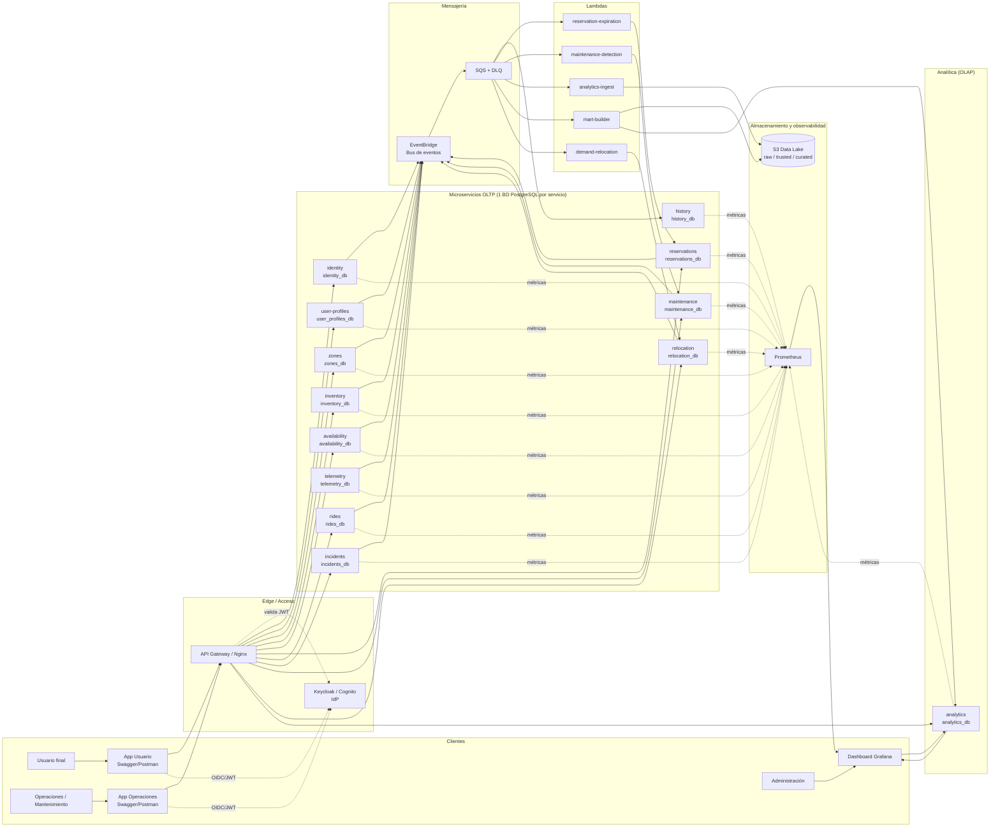
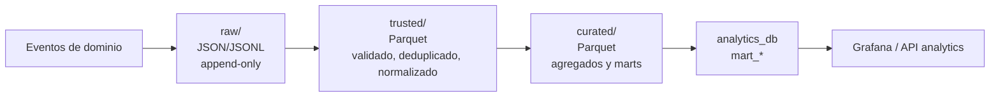

# Diagrama de servicios y conexiones (UrbanMove)

> Diagrama de referencia basado en [ARCHITECTURE.md](ARCHITECTURE.md),
> [SERVICE-CLASSIFICATION.md](SERVICE-CLASSIFICATION.md), [EVENTS.md](EVENTS.md) y
> [DATA-ARCHITECTURE.md](DATA-ARCHITECTURE.md).

## 0. Leyenda rápida

- **Microservicio**: componente independiente con una responsabilidad concreta, su propia API/lógica y despliegue independiente.
- **`<servicio>_db`**: base de datos **PostgreSQL privada** de ese microservicio. Solo ese servicio puede leer/escribir en ella; los demás se integran mediante APIs o eventos (nunca accediendo directamente a su BD).
- **OLTP**: servicios transaccionales que gestionan el estado operativo del negocio en tiempo real (reservas, viajes, incidencias, etc.).
- **OLAP**: servicio analítico (`analytics`) orientado a consultas/agregados sobre datos preparados (marts), no a operaciones transaccionales.
- **Evento**: hecho ocurrido en pasado que se publica en el bus (EventBridge → SQS). Sirve para desacoplar servicios y alimentar procesos asíncronos.
- **Consumidor de evento**: cualquier componente que reacciona al evento (otro microservicio, una Lambda, o el pipeline analítico). `history` y `analytics-ingest` actúan como consumidores transversales de los eventos de dominio para guardar historial y alimentar el Data Lake.

## 1. Qué es cada componente

| Componente | Qué hace | Base de datos / almacén |
|---|---|---|
| `zones` | Gestiona las zonas geográficas/operativas (áreas de uso, restricciones, etc.). | `zones_db` (privada) |
| `identity` | Gestiona identidades y roles de negocio en la plataforma (fachada sobre el IdP para administración). | `identity_db` (privada); credenciales/sesiones en Keycloak/Cognito |
| `user-profiles` | Gestiona el perfil del usuario (datos de perfil asociados al usuario). | `user_profiles_db` (privada) |
| `inventory` | Gestiona la flota como activos: alta/compra, baja/retirada y ficha del vehículo. | `inventory_db` (privada) |
| `availability` | Mantiene el **estado operativo actual** de cada vehículo (disponible, reservado, en uso, retirado, etc.) aplicando reglas de transición. | `availability_db` (privada) |
| `telemetry` | Recibe lecturas de telemetría (batería, posición, odómetro, etc.) y detecta señales como batería baja. | `telemetry_db` (privada) |
| `reservations` | Crea y gestiona reservas, cancelaciones y expiraciones (evita doble reserva). | `reservations_db` (privada) |
| `rides` | Gestiona el ciclo del viaje (inicio/fin) y registra el viaje completado (`TripRecorded`). | `rides_db` (privada) |
| `incidents` | Registra incidencias/averías reportadas sobre vehículos o servicio. | `incidents_db` (privada) |
| `maintenance` | Gestiona órdenes y tareas de mantenimiento (retirar/devolver vehículo a servicio, reparar/cargar). | `maintenance_db` (privada) |
| `relocation` | Gestiona órdenes de recolocación de vehículos entre zonas según demanda. | `relocation_db` (privada) |
| `history` | Guarda un historial consultable de lo ocurrido (registro append-only de eventos relevantes). Es OLTP de lectura, no analítico. | `history_db` (privada) |
| `analytics` | Servicio analítico: expone consultas sobre **marts** (datos agregados/preparados) para dashboard y operación. | `analytics_db` (privada, analítica) |
| `Keycloak / Cognito` | Proveedor de identidad (login, tokens, credenciales, sesiones). | `keycloak_db` en local (si aplica) o servicio gestionado |
| `EventBridge + SQS/DLQ` | Bus de eventos y colas para entrega asíncrona, reintentos y mensajes fallidos. | — (infraestructura de mensajería) |
| `S3 Data Lake` | Almacenamiento analítico por capas: `raw/` (eventos tal cual), `trusted/` (validados/normalizados), `curated/` (agregados). | Buckets/rutas en S3 (LocalStack en local) |
| `Prometheus` | Recolecta métricas técnicas/de negocio expuestas por los servicios. | TSDB de Prometheus |
| `Grafana` | Visualización de métricas y paneles analíticos/operativos. | Lee de Prometheus y/o `analytics`/`analytics_db` según panel |

## 2. Vista general (servicios, datos y mensajería)

> Nota: el nodo `identity` aparece como `IDN` por legibilidad; su base es `identity_db`. `telemetry` no se expone habitualmente como ruta de usuario en el gateway, pero ingesta/publica eventos según el diseño.

## 2. Conexiones por servicio

| Servicio | Tipo | Base de datos | Entrada principal | Publica eventos | Consume eventos / depende de | Salidas relevantes |
|---|---|---|---|---|---|---|
| `zones` | OLTP | `zones_db` | API Gateway (`/zones`) | `ZoneCreated` | — | Catálogo de zonas |
| `identity` | OLTP | `identity_db` | API Gateway (`/auth`, `/users`, `/roles`), Keycloak | `UserRegistered` | Keycloak (credenciales/sesiones externas) | Identidad y roles |
| `user-profiles` | OLTP | `user_profiles_db` | API Gateway (`/profiles`) | `UserProfileUpdated` | `UserRegistered` | Perfil de usuario |
| `inventory` | OLTP | `inventory_db` | API Gateway (`/vehicles`, `/acquisitions`) | `VehiclePurchased`, `VehicleRetired` | — | Activos de flota |
| `availability` | OLTP | `availability_db` | API Gateway (`/availability`) | `VehicleAvailabilityChanged` | `VehicleReserved`, `VehiclePickedUp`, `VehicleDroppedOff`, `VehicleBatteryLow`, `VehicleWithdrawnForMaintenance`, `VehicleReturnedToService` | Estado operativo del vehículo |
| `telemetry` | OLTP | `telemetry_db` | Ingesta de telemetría (`/telemetry`) | `TelemetryReceived`, `VehicleBatteryLow` | — | Lecturas y batería |
| `reservations` | OLTP | `reservations_db` | API Gateway (`/reservations`) | `VehicleReserved`, `ReservationCancelled`, `ReservationExpired` | `VehiclePickedUp`, `VehicleDroppedOff` | Reservas |
| `rides` | OLTP | `rides_db` | API Gateway (`/rides`) | `VehiclePickedUp`, `VehicleDroppedOff`, `TripRecorded` | `VehicleReserved` | Viajes |
| `incidents` | OLTP | `incidents_db` | API Gateway (`/incidents`) | `IncidentReported` | — | Incidencias |
| `maintenance` | OLTP | `maintenance_db` | API Gateway (`/maintenance-orders`) | `VehicleWithdrawnForMaintenance`, `VehicleReturnedToService`, `MaintenanceOrderOpened`, `MaintenanceOrderCompleted` | `VehicleBatteryLow`, `IncidentReported` | Órdenes de mantenimiento |
| `relocation` | OLTP | `relocation_db` | API Gateway (`/relocation-orders`) | `RelocationOrderCreated`, `RelocationOrderCompleted` | `DemandHotspotDetected` | Órdenes de recolocación |
| `history` | OLTP (lectura) | `history_db` | API Gateway (`/history`) | — | Todos los eventos de dominio | Historial consultable |
| `analytics` | OLAP | `analytics_db` | API Gateway (`/analytics`), Grafana | — (lee marts) | Datos curados/marts construidos por `mart-builder` | Marts y consultas analíticas |

## 3. Lambdas y flujo asíncrono

| Lambda | Disparador / entrada | Procesa | Escribe / notifica a |
|---|---|---|---|
| `reservation-expiration` | Eventos/temporización de reservas vía SQS/EventBridge | Detecta reservas no confirmadas vencidas | `reservations` (expiración/liberación) |
| `maintenance-detection` | Eventos como `VehicleBatteryLow`, `IncidentReported` vía SQS | Decide apertura/acciones de mantenimiento | `maintenance` (y efectos sobre disponibilidad vía eventos) |
| `analytics-ingest` | Eventos de dominio vía SQS | Valida y vuelca a capa raw | S3 Data Lake `raw/` |
| `mart-builder` | Eventos/datos procesados vía SQS o flujo analítico | Construye `trusted/` y `curated/` y actualiza marts | S3 `trusted/curated` y `analytics_db` |
| `demand-relocation` | Señales de demanda / `mart_demanda` (evaluación periódica) | Detecta hotspots y genera órdenes | `relocation` (`DemandHotspotDetected` / órdenes) |

## 4. Eventos y consumidores (aclaración)

- **No todos los eventos tienen el mismo tipo de consumidor.** Algunos disparan lógica en otros microservicios; otros alimentan historial/analítica o sirven como señal operativa/visual.
- **Consumidores transversales:** según el diseño, `history` persiste el historial de negocio y el pipeline analítico (`analytics-ingest` → S3 `raw/trusted/curated` → `mart-builder` → `analytics_db`) consume los eventos de dominio para ingesta y construcción de marts. Por eso, aunque un evento no tenga un "servicio de negocio" reaccionando directamente, suele tener **consumo asíncrono** para trazabilidad y analítica.
- **Consumidores directos por evento (ejemplos del catálogo):**
  - `UserRegistered` → `user-profiles` (+ historial/analítica).
  - `VehicleReserved` → `availability`, `rides` (+ historial/analítica).
  - `VehiclePickedUp` / `VehicleDroppedOff` → `availability`, `rides`/`reservations` según flujo (+ historial/analítica).
  - `VehicleBatteryLow` / `IncidentReported` → `maintenance` (y procesos de detección) (+ historial/analítica).
  - `DemandHotspotDetected` → `relocation` (+ historial/analítica).
- **Eventos sin consumidor "microservicio" directo:** por ejemplo `MartBuildCompleted` es un evento de capa CURATED que indica que los marts se han actualizado; sus consumidores naturales son la capa de visualización/operación (p. ej. Grafana/procesos operativos) más que un servicio OLTP. Esto es esperable y no implica que el evento esté "suelto" si cumple su propósito de señalización dentro del flujo analítico.
- **Resumen:** en la tabla de la sección 2, la columna "Consume eventos / depende de" indica dependencias/consumos directos relevantes del servicio; no repite sistemáticamente `history` y `analytics-ingest` para no sobrecargarla, pero ambos forman parte del consumo transversal del bus.

## 5. Capas de datos (Data Lake)

## 6. Notas de despliegue (contexto)

- **Local (por defecto):** Docker Compose con PostgreSQL (bases operacionales + analítica según plan), LocalStack, Keycloak, Prometheus, Grafana, servicios Spring Boot y Lambdas contra LocalStack.
- **AWS:** equivalentes gestionados (p. ej. S3, EventBridge, SQS, Lambda, RDS, CloudWatch/Cognito según fase), manteniendo la misma separación lógica de servicios y datos.

> Para el detalle de contratos de eventos, estados y reglas de negocio, consultar [EVENTS.md](EVENTS.md) y [ARCHITECTURE.md](ARCHITECTURE.md).
