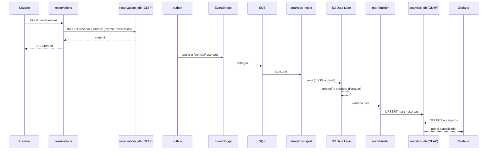

# OLTP y OLAP en UrbanMove

> **Estado:** propuesta para revisión del equipo.
> **Última actualización:** 2026-11-11.
> **Ámbito:** diferencia entre carga transaccional y analítica, topología local, topología
> AWS, flujo de datos, consistencia, rendimiento y reglas de operación.
> **Documentos relacionados:** [DATA-ARCHITECTURE.md](DATA-ARCHITECTURE.md) (almacenes y
> marts), [SERVICE-CLASSIFICATION.md](SERVICE-CLASSIFICATION.md) (qué servicio es OLTP y
> cuál OLAP), [ARCHITECTURE.md](ARCHITECTURE.md) (servicios),
> [EVENTS.md](EVENTS.md) (eventos), [EVENT-SOURCING.md](EVENT-SOURCING.md) (event store y
> proyecciones), [ADR 0003](adr/0003-kappa-medallion.md) (Kappa + Medallón),
> [ADR 0006](adr/0006-dos-instancias-rds.md) (dos instancias RDS) y
> [ADR 0007](adr/0007-event-sourcing-raw-trusted-curated.md) (event sourcing).

---

## 0. Resumen de la decisión

| Pregunta | Respuesta |
|---|---|
| ¿Se separan OLTP y OLAP? | **Sí, lógicamente siempre; físicamente en AWS** |
| ¿Qué es OLTP aquí? | Las 12 bases de servicio + `keycloak_db` |
| ¿Qué es OLAP aquí? | `analytics_db` con los data marts, alimentada desde el Data Lake |
| ¿Se usa un almacén analítico dedicado? | **No**: PostgreSQL basta para el volumen del proyecto |
| ¿Local y AWS son iguales? | Mismo diseño lógico; en local comparten contenedor, en AWS van en dos RDS |
| ¿Grafana consulta la base operacional? | **Nunca**. Solo `analytics_db` o la API de `analytics` |

La frase que resume el diseño: **OLTP responde "¿cuál es el estado ahora?"; OLAP responde
"¿qué ha pasado y por qué?".** Son dos preguntas distintas y no deben competir por el
mismo servidor.

---

## 1. Qué significa OLTP y qué significa OLAP

### 1.1. Definición corta

| | **OLTP** (*Online Transaction Processing*) | **OLAP** (*Online Analytical Processing*) |
|---|---|---|
| Pregunta | "¿Está libre la bici 42?" | "¿Cuántos viajes por zona y hora?" |
| Operación típica | `INSERT` de eventos y lectura de la vista `*_current` | `SELECT` con `JOIN`, `GROUP BY`, agregaciones |
| Alcance | Una entidad o una transacción | Millones de filas o todo el histórico |
| Frecuencia | Muchas operaciones pequeñas por segundo | Pocas consultas grandes, programadas o bajo demanda |
| Latencia objetivo | Milisegundos | Segundos o minutos; se admite caché |
| Consistencia | Fuerte, ACID | Eventual; el dato puede tener minutos de retraso |
| Usuarios | Aplicaciones y APIs | Analistas, Grafana, informes, modelos |
| Esquema | Normalizado, orientado a evitar duplicidad | Desnormalizado, orientado a leer rápido (estrella) |
| Índices | Muchos y selectivos (B-tree, únicos parciales) | Pocos, sobre columnas de filtro y agrupación |
| Mutabilidad | Event store append-only; estado en proyecciones por versión | Marts append-only por `build_id` |

### 1.2. En UrbanMove

| Carga | Dónde vive | Ejemplo real |
|---|---|---|
| **OLTP** | `identity_db`, `user_profiles_db`, `inventory_db`, `availability_db`, `reservations_db`, `rides_db`, `history_db`, `maintenance_db`, `relocation_db`, `zones_db`, `telemetry_db`, `incidents_db`, `keycloak_db` | Reservar una bici, iniciar un viaje, retirar un vehículo |
| **OLAP** | `analytics_db` (marts) + S3 `curated/` | Viajes por zona, ocupación media, demanda por hora |
| **Puente** | S3 `raw/` y `trusted/` | `VehiclePickedUp` y `VehicleDroppedOff` tal como llegaron; `TripRecorded` ya validado |

> **Matiz importante:** `history` es OLTP, no OLAP. Guarda el historial de negocio
> consultable por usuario y por viaje, con las mismas garantías transaccionales que el
> resto. Los marts son otra cosa: agregados derivados para análisis.

---

## 2. Por qué separar OLTP y OLAP

### 2.1. El problema de mezclarlos

Si Grafana consulta directamente `rides_db`:

1. Una consulta de agregación recorre toda la tabla de viajes y **compite por CPU y
   disco** con las reservas que están entrando.
2. Puede **bloquear filas** o mantener transacciones largas que impiden el `VACUUM`.
3. Un `GROUP BY` grande llena `work_mem` y provoca escrituras temporales a disco.
4. Un error en el panel puede **tumbar la operación**, no solo el informe.
5. Los índices que necesita OLTP (selectivos, muchos) **estorban** a OLAP, y los que
   necesita OLAP (columnas de agrupación) **estorban** a OLTP.

### 2.2. La separación que se adopta

```text
OLTP: muchas transacciones pequeñas, estado vivo, ACID
   │
   │ outbox + eventos (no doble escritura)
   ▼
Data Lake: histórico inmutable en S3 raw/ → trusted/ → curated/
   │
   │ Lambda mart-builder
   ▼
OLAP: analytics_db con marts agregados, solo lectura para Grafana
```

Reglas derivadas:

- **Nunca se consulta OLTP desde OLAP.** Ni con un `JOIN`, ni con un *foreign data
  wrapper*, ni con una vista remota.
- **Nunca se escribe OLAP desde un servicio de negocio.** Solo `mart-builder`.
- **Nunca se analiza sobre la base operacional** "porque es más rápido". Es la deuda
  técnica que este documento evita.
- La separación **no depende de tener dos servidores**. Se puede cumplir con dos bases
  en el mismo PostgreSQL; lo que no se puede es mezclar cargas en la misma base.

### 2.3. Por qué no un almacén dedicado (Redshift, Athena, Snowflake)

| Opción | Veredicto | Motivo |
|---|---|---|
| **PostgreSQL `analytics_db`** | **Elegida** | El volumen es pequeño (decenas de miles de filas), el equipo ya lo conoce y encaja con la rúbrica |
| Amazon Redshift | Descartado | Coste y complejidad desproporcionados; clúster que hay que apagar |
| Athena sobre `curated/` | Opcional | Sirve para consultas ad-hoc sobre Parquet, pero no sustituye a los marts |
| DuckDB local | Opcional | Útil para probar analítica sin levantar nada, pero no es el runtime del proyecto |
| DynamoDB | Descartado para OLAP | No está pensado para agregaciones ni `GROUP BY` |

La decisión se justifica por **escala y tiempo**, no por moda: con 7 marts y datos de
una demo, PostgreSQL es suficiente y se puede reconstruir en segundos.

---

## 3. Flujo completo de un dato

### 3.1. De la transacción al panel



Puntos clave:

- El usuario recibe respuesta **antes** de que el dato llegue a OLAP. La analítica es
  eventual por diseño.
- La transacción de negocio y el evento van juntos en el **outbox**. No hay doble
  escritura contra S3 ni contra `analytics_db`.
- Si `analytics-ingest` o `mart-builder` fallan, la reserva sigue siendo válida. El
  mensaje queda en SQS o en la DLQ y se reprocesa.
- El mismo evento existe a la vez en el outbox, en SQS y en S3. No se "mueve": se
  **copia** en formas distintas.

### 3.2. Frescura del dato

| Trayecto | Retraso típico | Garantía |
|---|---|---|
| OLTP (reserva confirmada) | 0 | Fuerte, ACID |
| Evento en `raw/` | Segundos | Al menos una vez |
| `trusted/` y `curated/` | Segundos o minutos | Idempotente, deduplicado |
| Mart actualizado | Minutos (ventana) | Reconstruible |
| Panel de Grafana | Minutos | Lectura de solo agregados |

No se promete "tiempo real" en el dashboard. Se promete **corrección y reconstrucción**.
Para la demo, un retraso de un minuto es aceptable y se explica.

---

## 4. OLTP en detalle

### 4.1. Responsabilidades

- Validar reglas de negocio y restricciones.
- Garantizar atomicidad: una reserva se crea o no se crea.
- Evitar doble reserva con versión esperada del agregado y stream por vehículo.
- Publicar eventos mediante outbox en la misma transacción.
- Responder con latencia baja a la API.

### 4.2. Diseño de datos

| Aspecto | Decisión |
|---|---|
| Normalización | Tercera forma normal como norma; duplicar solo con motivo |
| Claves | `UUID` o `BIGSERIAL` según el servicio; nunca claves autoincrementales globales |
| Relaciones | Dentro del servicio, claves foráneas; **entre servicios, nunca** |
| Índices | Clave primaria, `UNIQUE (aggregate_id, aggregate_version)`, `(id, version)` de proyección y claves de búsqueda frecuente |
| Restricciones | `NOT NULL`, `CHECK`, `UNIQUE`; la lógica no sustituye a la base |
| Borrado | No se borra: se emite un evento de corrección o baja |
| Migraciones | Flyway versionado; nunca cambios a mano en producción |

### 4.3. Transacciones y aislamiento

- Nivel por defecto: `READ COMMITTED`. Es suficiente para reservas y viajes.
- La doble reserva **no** se resuelve con `SERIALIZABLE`, sino con la versión esperada del
  agregado (`UNIQUE (aggregate_id, aggregate_version)`) y el stream
  `vehicle-reservation-<vehicleId>`. Menos contención y más claro.
- Transacciones **cortas**: prohibido llamar a un servicio externo dentro de una
  transacción abierta.
- La publicación de eventos no se hace dentro del hilo de la transacción: se escribe en
  el outbox y un publicador lo envía después.

### 4.4. Conexiones

- Un pool pequeño por servicio (5-10 conexiones). Doce servicios con pools grandes
  agotan una instancia pequeña.
- Nunca se comparte un pool entre servicios.
- `statement_timeout` corto en OLTP (por ejemplo 5 s) para que una consulta mala no
  bloquee la API.
- En AWS, si el número de conexiones crece, se evalúa **RDS Proxy** o **PgBouncer**,
  no aumentar el pool sin control.

---

## 5. OLAP en detalle

### 5.1. Responsabilidades

- Responder preguntas agregadas sin tocar la operación.
- Ser **reconstruible** desde el Data Lake.
- Mantener un esquema sencillo de entender para el equipo y para Grafana.
- Servir de base a `relocation` mediante `mart_demanda`.

### 5.2. Diseño de datos

| Aspecto | Decisión |
|---|---|
| Modelo | Estrella: una tabla de hechos y dimensiones alrededor |
| Grano | Declarado por mart (`zona/hora`, `usuario/día`, …) |
| Claves | Surrogadas e IDs de negocio; sin claves foráneas rígidas |
| Duplicados | `UPSERT` por clave de negocio y ventana; idempotente |
| Reconstrucción | `TRUNCATE` + recarga, o borrado por ventana y recarga |
| Índices | Sobre columnas de filtro y agrupación; pocos y amplios |
| Retención | La que pida el dashboard; el histórico completo vive en S3 |

### 5.3. Por qué no vistas materializadas sobre OLTP

Una vista materializada sobre `rides_db` seguiría dependiendo de la base operacional:
- el refresco compite con las escrituras;
- si OLTP cae, OLAP cae con él;
- no se puede reconstruir desde el histórico si el dato se perdió.

Los marts se construyen desde S3, que es la fuente **inmutable** y completa.

### 5.4. Consultas

- `analytics_db` tiene un usuario `grafana_ro` con `SELECT` únicamente.
- `statement_timeout` más largo que en OLTP, pero acotado (por ejemplo 30 s).
- Las consultas de Grafana usan intervalos y filtros; nunca `SELECT *` sobre un mart
  entero.
- Si un panel va lento, se agrega más en el mart; no se optimiza el panel a base de
  tocar OLTP.

---

## 6. Topología local

### 6.1. Diseño por defecto: un contenedor, dos mundos lógicos

```text
Docker Compose
└── postgres:16
    ├── identity_db          ┐
    ├── user_profiles_db     │
    ├── inventory_db         │
    ├── availability_db      │
    ├── reservations_db      │  OLTP
    ├── rides_db             │  (12 bases de servicio)
    ├── history_db           │
    ├── maintenance_db       │
    ├── relocation_db        │
    ├── zones_db             │
    ├── telemetry_db         │
    ├── incidents_db         │
    ├── keycloak_db          ┘
    └── analytics_db         ← OLAP (marts)
```

| Ventaja | Limitación |
|---|---|
| Consume poca RAM: un solo PostgreSQL | CPU, disco y `shared_buffers` compartidos |
| Arranque rápido y reproducible | Una consulta analítica puede notarse en la API |
| Equivale al **plan B** de AWS | No reproduce el aislamiento físico de dos RDS |
| Mismos scripts de creación de bases | No hay réplica de lectura local |

**La separación lógica se mantiene**: ningún servicio lee `analytics_db`, y Grafana no
lee ninguna base operacional. Lo que falta es el aislamiento físico, y se declara como
limitación del entorno.

### 6.2. Cómo evitar que OLAP moleste en local

1. **Datos pequeños:** el `seed` genera lo justo para la demo, no millones de filas.
2. **Marts bajo demanda:** `mart-builder` se ejecuta al terminar una ventana o a mano,
   no en bucle.
3. **Límites de Docker:** si hace falta, `--memory` y `--cpus` al contenedor de
   PostgreSQL, y perfiles de Compose para no arrancar los 13 servicios a la vez.
4. **Consultas acotadas:** Grafana con intervalos y `LIMIT`; nada de explorar tablas
   completas.
5. **Tests separados:** Testcontainers levanta su propio PostgreSQL efímero por suite;
   los tests nunca comparten instancia con el entorno de demo.

### 6.3. Variante realista: dos contenedores

Con 16 GB de RAM se puede reproducir la topología de AWS:

```text
postgres-oltp:16      → 13 bases operacionales
postgres-analytics:16 → analytics_db
```

Ventajas: se demuestra el aislamiento y se puede apagar OLAP sin tocar OLTP. Coste: más
RAM, dos scripts de inicialización y dos cadenas de conexión. **No es el modo por
defecto**, pero es la forma de ensayar la demo de "OLAP cae y la operación sigue".

### 6.4. Qué no se levanta en local

- No hay réplica de lectura: no aporta con este volumen.
- No hay Redshift ni Athena: el Data Lake se emula con LocalStack y los marts con
  PostgreSQL.
- No hay Multi-AZ: se documenta que AWS lo aporta.

---

## 7. Topología AWS

### 7.1. Diseño objetivo: dos instancias RDS

```text
                         ┌──────────────────────────────┐
Microservicios  ────────►│ RDS operacional              │
(EC2 + Compose)          │ 12 bases + keycloak_db       │
                         └──────────────┬───────────────┘
                                        │ outbox → EventBridge → SQS
                                        ▼
                         ┌──────────────────────────────┐
                         │ S3 Data Lake                 │
                         │ raw/ → trusted/ → curated/   │
                         └──────────────┬───────────────┘
                                        │ Lambda mart-builder
                                        ▼
                         ┌──────────────────────────────┐
Grafana / analytics ────►│ RDS analítico                │
                         │ analytics_db (7 marts)       │
                         └──────────────────────────────┘
```

| Instancia | Contenido | Configuración |
|---|---|---|
| `urbanmove-operational` | 12 bases de servicio + `keycloak_db` | Subnet privada, security group solo desde los servicios; backups y PITR |
| `urbanmove-analytics` | `analytics_db` | Subnet privada, acceso solo desde `mart-builder`, `analytics` y Grafana (lectura) |

Aislamiento que aporta AWS y no aporta local:

- CPU, memoria y IOPS separadas.
- Un fallo o una consulta pesada en OLAP no afecta a las reservas.
- Backups y recuperación independientes.
- Posibilidad de réplica de lectura en analítica.
- Métricas y alarmas por instancia en CloudWatch.

### 7.2. Plan B: una instancia, 14 bases

Si AWS Academy no permite dos instancias o el crédito no llega:

```text
RDS "urbanmove" ── 14 bases
    ├── 12 de servicio + keycloak_db   (OLTP)
    └── analytics_db                   (OLAP)
```

Es la **misma arquitectura lógica** con menos aislamiento físico. No cambia código: solo
`DB_HOST` y `DB_NAME` en `analytics` y `mart-builder`. La separación se mantiene por
base de datos, usuario y permisos.

### 7.3. Réplica de lectura: cuándo sí y cuándo no

| Uso | ¿Réplica? | Motivo |
|---|---|---|
| Descargar lecturas de la API | Sí, si hay contención | Escala lecturas sin tocar el writer |
| Servir paneles de Grafana | **No** | Grafana debe leer `analytics_db`, no OLTP |
| Ejecutar agregaciones grandes | **No** | Una réplica no convierte OLTP en OLAP |
| Disaster recovery | Multi-AZ, no réplica | La réplica de lectura no conmuta sola |

La réplica de lectura es una herramienta de **escalado de lectura operacional**, no un
sustituto de la capa analítica.

### 7.4. Seguridad y red

- Ambas instancias en subredes privadas; sin acceso público.
- Security groups distintos: el operacional solo acepta tráfico de servicios; el
  analítico, de `mart-builder`, `analytics` y Grafana.
- Usuarios de base distintos por servicio; `analytics` solo `SELECT` sobre marts.
- Credenciales en Secrets Manager o variables de entorno; **nunca** en el repositorio.
- Cifrado en reposo y en tránsito (`sslmode=require`).

---

## 8. Comparativa local frente a AWS

| Aspecto | Local | AWS Academy | AWS real (opcional) |
|---|---|---|---|
| Instancias | 1 contenedor | 2 RDS (o 1 en plan B) | 2 RDS Multi-AZ |
| OLTP | 13 bases | 13 bases | 13 bases |
| OLAP | `analytics_db` | `analytics_db` | `analytics_db` + réplica |
| Aislamiento físico | No | Sí | Sí, con alta disponibilidad |
| Réplica de lectura | No | Opcional | Sí en analítica |
| Backups | Volumen local | Automáticos + PITR | Automáticos + PITR |
| Multi-AZ | No | Normalmente no | Sí |
| Coste | 0 € | Crédito de Academy | Factura mensual |
| Datos | Seed de demo | Seed + eventos | Datos reales |
| Latencia analítica | Minutos | Minutos | Minutos |
| Código | Idéntico | Idéntico | Idéntico |

**Conclusión:** el código y los contratos no cambian. Cambian el host, el tamaño y las
garantías de disponibilidad. Por eso el diseño se valida en local y se despliega después.

---

## 9. Consistencia y recuperación

### 9.1. Qué garantiza cada capa

| Capa | Garantía | Qué implica |
|---|---|---|
| OLTP | ACID | La reserva existe o no existe; no hay estados a medias |
| Outbox | Atomicidad local | El evento se guarda con el cambio de negocio |
| SQS | Al menos una vez | Puede haber duplicados; el consumidor es idempotente |
| S3 `raw/` | Inmutable | Se conserva el original para auditar y reprocesar |
| `trusted/` y `curated/` | Idempotentes | Reprocesar no duplica |
| Marts | Reconstruibles | Se pueden borrar y recargar sin pérdida |
| Dashboard | Eventual | Puede mostrar datos de hace unos minutos |

### 9.2. Qué pasa si falla OLAP

- La operación continúa: reservas, viajes y mantenimiento no dependen de `analytics_db`.
- Los eventos siguen llegando a S3.
- Cuando vuelve `mart-builder`, se reprocesa la ventana y los marts se reconstruyen.
- Evidencia para la demo: panel vacío o desactualizado, luego recuperado.

### 9.3. Qué pasa si falla OLTP

- La API de ese servicio deja de responder; el resto puede seguir.
- Los eventos ya confirmados esperan en SQS; los no confirmados no existen.
- Al recuperar la instancia, se reanuda el outbox y se procesa el atraso.
- La analítica puede seguir mostrando datos antiguos; no se inventan datos.

### 9.4. Qué nunca se hace para "arreglar" la frescura

- Escribir directamente en `analytics_db` desde un servicio.
- Consultar OLTP desde Grafana.
- Duplicar la escritura (base + S3) fuera del outbox.
- Recalcular marts dentro de la transacción de negocio.

---

## 10. Rendimiento y dimensionamiento

### 10.1. Perfil de cada carga

| Recurso | OLTP | OLAP |
|---|---|---|
| CPU | Picos por transacción | Picos por agregación |
| Memoria | `shared_buffers` y conexiones | `work_mem` para ordenaciones |
| Disco | Escrituras pequeñas y frecuentes | Lecturas secuenciales grandes |
| Conexiones | Muchas, cortas | Pocas, largas |
| Índices | Muchos y selectivos | Pocos y amplios |
| Autovacuum | Crítico | Menos crítico |

### 10.2. Tamaños orientativos

| Entorno | OLTP | OLAP |
|---|---|---|
| Local | Contenedor con 2-4 GB para PostgreSQL | Comparte el mismo contenedor |
| AWS Academy | `db.t4g.micro` o `small`, 20 GB | `db.t4g.micro`, 20 GB |
| AWS real | `db.t4g.medium` o superior, Multi-AZ | Instancia menor + réplica |

No se dimensiona para "miles de usuarios" porque el proyecto no los tiene. Se dimensiona
para que la demo funcione y para que el diseño escale verticalmente sin reescribir.

### 10.3. Cuellos de botella esperados

| Cuello | Dónde | Mitigación |
|---|---|---|
| Pool de conexiones agotado | OLTP | Pools pequeños, PgBouncer/RDS Proxy |
| Consulta de panel lenta | OLAP | Agregar más en el mart, índices, límites |
| `VACUUM` retrasado | OLTP | Transacciones cortas, autovacuum ajustado |
| Mart desactualizado | OLAP | Reproceso de ventana, alarma de retraso |
| Coste de dos RDS | AWS | Plan B de una instancia, apagar fuera de horario |

---

## 11. Anti-patrones

| Anti-patrón | Por qué está mal | Qué se hace |
|---|---|---|
| Grafana conectado a `reservations_db` | Compten por recursos y puede bloquear | Leer `analytics_db` o API de `analytics` |
| `JOIN` entre bases de dos servicios | Rompe la propiedad de datos | Componer en el servicio o vía evento |
| Escribir en S3 dentro de la transacción | Doble escritura no atómica | Outbox y publicador |
| Actualizar un mart con `valor = valor + 1` | No idempotente ni reconstruible | `UPSERT` por clave y ventana |
| Usar la base operacional como histórico | Crece sin control y degrada OLTP | S3 `raw/` + marts |
| Réplica de lectura como capa OLAP | Las agregaciones siguen compitiendo | Marts precalculados |
| `SELECT *` en un panel | Lee columnas y filas innecesarias | Consultas con filtros y agregados |
| Añadir índices "por si acaso" en OLTP | Ralentiza escrituras | Índices justificados por consulta |

---

## 12. Checklist de aceptación

- [ ] Cada servicio tiene su base y ningún servicio lee la de otro.
- [ ] `analytics_db` solo la escribe `mart-builder`.
- [ ] Grafana usa `grafana_ro` con `SELECT` y nunca toca OLTP.
- [ ] Los marts se pueden reconstruir desde S3 y está documentado cómo.
- [ ] El flujo de un evento se puede explicar de punta a punta.
- [ ] Se ha probado la demo "OLAP caído, operación viva".
- [ ] Se ha probado la demo "evento duplicado, sin doble agregación".
- [ ] En local se declara la limitación de compartir contenedor.
- [ ] En AWS se declara si se usa el plan de dos instancias o el plan B.
- [ ] Ningún panel de Grafana consulta una base operacional.

---

## 13. Referencias

- [DATA-ARCHITECTURE.md](DATA-ARCHITECTURE.md): almacenes, S3, Parquet, marts y RDS.
- [SERVICE-CLASSIFICATION.md](SERVICE-CLASSIFICATION.md): clasificación OLTP/OLAP por servicio.
- [EVENT-SOURCING.md](EVENT-SOURCING.md): event store, proyecciones y capas.
- [EVENTS.md](EVENTS.md): catálogo de eventos, publicación, idempotencia y DLQ.
- [DATA-MODEL.md](DATA-MODEL.md) y [DATA-DICTIONARY.md](DATA-DICTIONARY.md): tablas.
- [ARCHITECTURE.md](ARCHITECTURE.md): catálogo de servicios y comunicación.
- [ADR 0002](adr/0002-postgresql-vs-dynamodb.md): PostgreSQL como motor operacional.
- [ADR 0003](adr/0003-kappa-medallion.md): Kappa + Medallón.
- [ADR 0006](adr/0006-dos-instancias-rds.md): dos instancias RDS y plan B.
- [ADR 0007](adr/0007-event-sourcing-raw-trusted-curated.md): event sourcing inmutable.
