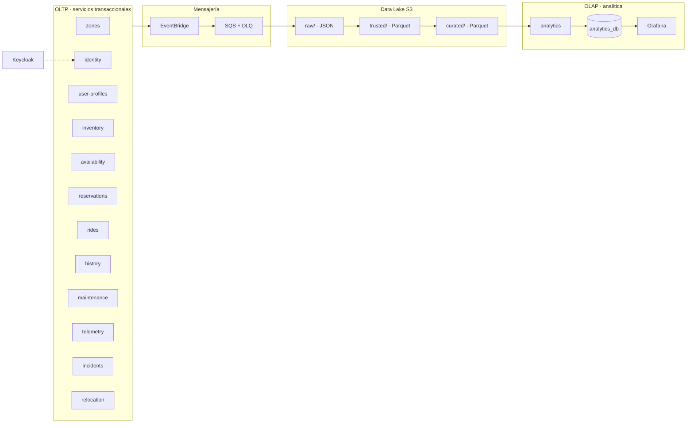

# Clasificación de microservicios: OLTP y OLAP

> **Estado:** propuesta para revisión del equipo.
> **Última actualización:** 2026-11-11.
> **Ámbito:** qué servicio es transaccional, cuál es analítico y cómo se relacionan.
> **Documentos relacionados:** [OLTP-OLAP.md](OLTP-OLAP.md) (conceptos y topologías),
> [DATA-MODEL.md](DATA-MODEL.md) (relaciones), [DATA-DICTIONARY.md](DATA-DICTIONARY.md)
> (atributos), [EVENT-SOURCING.md](EVENT-SOURCING.md) (eventos y capas),
> [ARCHITECTURE.md](ARCHITECTURE.md) (catálogo) y
> [ADR 0007](adr/0007-event-sourcing-raw-trusted-curated.md) (event sourcing).

---

## 1. Criterio de clasificación

| Tipo | Qué hace | Latencia | Consistencia | Ejemplo |
|---|---|---|---|---|
| **OLTP** | Cambia el estado del negocio | Milisegundos | Fuerte, ACID | Reservar una bici |
| **OLAP** | Agrega y analiza historia | Segundos o minutos | Eventual | Viajes por zona y hora |

Un servicio es OLAP si su razón de ser es **leer y agregar**, no operar. Que un servicio
lea mucho no lo convierte en OLAP: `history` es de lectura intensiva, pero sigue siendo
operacional.

---

## 2. Mapa



Lectura del diagrama:

- Los doce servicios de la izquierda son **OLTP**.
- `analytics` es el único **OLAP**.
- S3 es el **almacén analítico**, no un microservicio.
- Grafana visualiza; no es OLAP ni OLTP.
- Keycloak es infraestructura de identidad; no cuenta como servicio de negocio.

---

## 3. Tabla de clasificación

| Servicio | Tipo | Base de datos | Escribe | Lee | Nota |
|---|---|---|---|---|---|
| `zones` | **OLTP** | `zones_db` | `zone`, `zone_restriction` | `availability`, `relocation` | Catálogo operativo |
| `identity` | **OLTP** | `identity_db` | `user_account`, `role_assignment` | Todos los servicios | Keycloak gestiona credenciales |
| `user-profiles` | **OLTP** | `user_profiles_db` | `user_profile` | `history` | Datos de perfil |
| `inventory` | **OLTP** | `inventory_db` | `vehicle_model`, `vehicle_asset`, `acquisition` | `availability`, `telemetry`, `maintenance` | Ficha y ciclo de vida del vehículo |
| `availability` | **OLTP** | `availability_db` | `vehicle_availability` | `reservations`, `rides`, `maintenance` | Estado operativo; consume eventos de pickup/dropoff |
| `reservations` | **OLTP** | `reservations_db` | `reservation`, `reservation_attempt`, `reservation_slot` | `rides` | Evita doble reserva |
| `rides` | **OLTP** | `rides_db` | `open_trip`, `trip` | `history`, `analytics` | Produce el `TripRecorded` TRUSTED, pero opera en tiempo real |
| `history` | **OLTP** | `history_db` | `history_entry` | `analytics`, API | Append-only y lectura intensiva; **no es OLAP** |
| `maintenance` | **OLTP** | `maintenance_db` | `maintenance_order`, `maintenance_task` | `availability`, `history` | Órdenes de taller |
| `telemetry` | **OLTP** | `telemetry_db` | `telemetry_reading`, `telemetry_latest` | `maintenance`, `analytics` | Escritura alta; no es analítica |
| `incidents` | **OLTP** | `incidents_db` | `incident` | `maintenance`, `history` | Reporte de averías |
| `relocation` | **OLTP** | `relocation_db` | `relocation_order`, `relocation_item` | `history`, `analytics` | Órdenes de movimiento |
| `analytics` | **OLAP** | `analytics_db` | `mart_*` | Grafana, `relocation` | Único servicio analítico |
| Keycloak | Soporte | `keycloak_db` | Usuarios, sesiones, roles | `identity` | Sistema externo gestionado |
| S3 Data Lake | Almacén | — | `raw/`, `trusted/`, `curated/` | `analytics`, Athena | No es un servicio |
| Grafana | Visualización | — | — | `analytics_db` o API | No es OLAP |

**Resumen:** 12 servicios OLTP, 1 servicio OLAP, 1 sistema de identidad y 1 almacén
analítico.

---

## 4. Por qué estos servicios no son OLAP

### 4.1. `history` no es OLAP

`history` guarda el historial de negocio consultable por usuario, vehículo o viaje. Es
append-only y se lee mucho, pero:

- Responde a preguntas operativas ("¿qué viajes hizo este usuario?").
- Tiene el mismo modelo transaccional que el resto.
- No agrega ni construye marts.

Es un **OLTP de lectura**, no un almacén analítico.

### 4.2. `rides` no es OLAP

`rides` produce el `TripRecorded`, que es un registro TRUSTED, pero lo hace en el flujo
operativo:

- Marca el viaje en curso.
- Calcula duración y coste.
- Alimenta `history` y la analítica.

Sigue siendo OLTP porque su función es operar el viaje, no agregar historia.

### 4.3. `telemetry` no es OLAP

Recibe muchas escrituras por segundo y guarda lecturas recientes. No agrega ni consulta
histórico a gran escala: para eso está el Data Lake y `analytics`.

---

## 5. Frontera entre OLTP y OLAP

```text
OLTP                          Data Lake                     OLAP
-----                         ---------                     ----
event_store                   raw/                          analytics_db
proyecciones                  trusted/                      marts
APIs                          curated/
   │                              ▲                            ▲
   └──── eventos ──► EventBridge ─┘                            │
                              └────── mart-builder ───────────┘
```

Reglas:

- OLTP no consulta `analytics_db`.
- OLAP no escribe en bases operacionales.
- Grafana no consulta OLTP.
- El puente son los eventos y S3, nunca una consulta directa.

---

## 6. Checklist

- [ ] Los 12 servicios OLTP tienen base propia y event store.
- [ ] `analytics` es el único que escribe marts.
- [ ] `history` se documenta como OLTP de lectura, no como OLAP.
- [ ] Grafana solo lee `analytics_db` o la API de `analytics`.
- [ ] Ningún servicio operacional lee `s3://.../raw/` en tiempo de ejecución.
