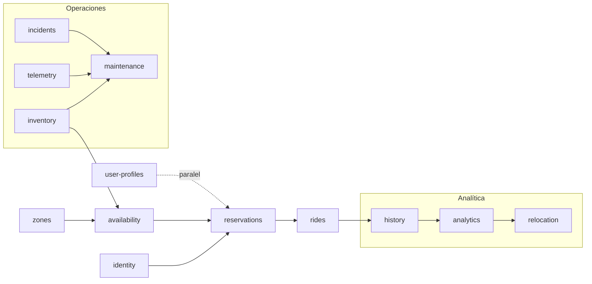

# Roadmap de microservicios

> **Estado:** propuesta para revisión del equipo.
> **Última actualización:** 2026-11-11.
> **Ámbito:** qué servicio se construye antes, de qué depende y qué se recorta si el
> plazo aprieta.
> **Documentos relacionados:** [ACTION-PLAN.md](../00-gestion/ACTION-PLAN.md) (calendario
> semanal), [PLAN.md](../00-gestion/PLAN.md) (fases y alcance),
> [ARCHITECTURE.md](ARCHITECTURE.md) (catálogo y comunicación),
> [GITHUB-WORKFLOW.md](../00-gestion/GITHUB-WORKFLOW.md) (cómo se convierte esto en
> issues) y [DATA-ARCHITECTURE.md](DATA-ARCHITECTURE.md) (persistencia y marts).

---

## 1. Resumen

- **13 microservicios** planificados.
- **10 obligatorios** según el enunciado.
- **3 extra** que completan la arquitectura: `zones`, `telemetry`, `incidents`.
- **7 servicios** forman el primer flujo completo que se puede demostrar.

La regla que ordena todo: **ningún servicio empieza hasta que su contrato está
cerrado**, aunque la implementación del servicio del que depende aún no haya terminado.

---

## 2. Niveles de alcance

| Nivel | Servicios | Para qué |
|---|---|---|
| **Obligatorios (10)** | `identity`, `user-profiles`, `inventory`, `availability`, `reservations`, `rides`, `history`, `maintenance`, `relocation`, `analytics` | Aprobar la asignatura |
| **Extra (3)** | `zones`, `telemetry`, `incidents` | Completar arquitectura y flujos |
| **Primera demo (7)** | `zones`, `identity`, `inventory`, `availability`, `reservations`, `rides`, `history` | Flujo de usuario de punta a punta |

`zones` no está entre los 10 obligatorios, pero se mantiene por dos motivos:

1. Es el **walking skeleton**: el primer servicio completo que valida la plantilla
   hexagonal, la persistencia, el contrato y el CI.
2. `availability` lo necesita para validar restricciones por zona.

Es barato de construir y desbloquea a los demás.

---

## 3. Camino crítico



Lectura:

- Sin `inventory` no hay vehículos.
- Sin `availability` no hay estado que reservar.
- Sin `reservations` no hay viaje.
- Sin `rides` no hay fin de viaje ni eventos para `history`.
- Sin `history` ni Data Lake no hay `analytics` ni `relocation`.

---

## 4. Orden de implementación

| Orden | Servicio | Obligatorio | Depende de | Qué desbloquea | Días |
|---|---|---|---|---|---|
| 1 | `zones` | No | — | `availability`, plantilla, demo | 1-2 |
| 2 | `identity` | Sí | Keycloak | Auth en todos, `reservations` | 2 |
| 3 | `inventory` | Sí | — | `availability`, `reservations`, `maintenance` | 2 |
| 4 | `availability` | Sí | `inventory`, `zones` | `reservations`, `rides` | 3 |
| 5 | `reservations` | Sí | `availability`, `identity` | `rides`, regla de doble reserva | 3-4 |
| 6 | `rides` | Sí | `reservations` | `history`, marts de viajes | 2-3 |
| 7 | `history` | Sí | eventos de todos | Flujo completo y evidencia de eventos | 2 |
| 8 | `user-profiles` | Sí | `UserRegistered` | Flujo de usuario completo | 1-2 |
| 9 | `maintenance` | Sí | `inventory`, eventos | Flujo de operaciones | 3 |
| 10 | `telemetry` | No | `inventory` | Alimenta `maintenance` | 2 |
| 11 | `incidents` | No | `inventory`, `zones` | Alimenta `maintenance` | 2 |
| 12 | `analytics` | Sí | Data Lake, marts | `relocation`, dashboard | 3-4 |
| 13 | `relocation` | Sí | `mart_demanda`, `zones`, `inventory` | Flujo de recolocación | 3 |

Dos matices que cambian el orden aparente:

1. **`user-profiles` va en paralelo desde la semana 2.** No bloquea nada, pero es
   obligatorio y barato. No se deja para el final.
2. **`analytics` no se empieza en la semana 6 desde cero.** La Lambda
   `analytics-ingest` se monta en la semana 2-3 para que el Data Lake acumule eventos.
   Si se espera al final, no hay histórico que analizar.

---

## 5. Contratos antes que código

Cada servicio se construye en este orden:

```text
1. Contrato OpenAPI + JSON Schema de sus eventos
2. Dominio y tests unitarios
3. Persistencia y tests con Testcontainers
4. Adaptadores REST y de mensajería
5. Outbox y publicación de eventos
6. Dockerfile y servicio en Compose
7. Documentación y colección de API
```

Regla de integración: **nadie empieza `reservations` hasta que `availability` tenga su
contrato cerrado**, aunque la implementación de `availability` aún no esté terminada.
Así los dos equipos pueden trabajar en paralelo sin bloquearse.

Contratos que se cierran primero:

| Contrato | Antes de empezar |
|---|---|
| OpenAPI de `zones` | `availability` |
| OpenAPI de `inventory` | `availability` |
| OpenAPI de `availability` | `reservations` |
| OpenAPI de `reservations` | `rides` |
| Eventos `VehiclePickedUp` / `VehicleDroppedOff` / `TripRecorded` | `history` y marts |
| Eventos `VehicleBatteryLow` / `IncidentReported` | `maintenance` |

---

## 6. Secuencia semanal

La secuencia corta, con objetivo y criterio de "hecho" por semana, está en
[ACTION-PLAN.md](../00-gestion/ACTION-PLAN.md), sección 2. Este documento solo fija el
orden de dependencias; no reparte nombres.

El reparto por dominio está en [PLAN.md](../00-gestion/PLAN.md), sección 20, y los
nombres reales se asignan en [KICKOFF.md](../00-gestion/KICKOFF.md), sección 6.

---

## 7. Hitos verificables

No son milestones de GitHub: son **comprobaciones** que se pueden enseñar en la demo.

| Hito | Servicios implicados | Cómo se comprueba |
|---|---|---|
| **H1 — Walking skeleton** | `zones` | `GET /zones` responde, hay test y CI verde |
| **H2 — Autenticación** | `identity` | Token con rol `user` y llamada protegida |
| **H3 — Flujo de usuario** | 7 servicios | Registro → reserva → viaje → fin → historial |
| **H4 — Eventos trazables** | event store, outbox, S3, SQS | `VehiclePickedUp` en `raw/` y `TripRecorded` en el historial |
| **H5 — Flujo de mantenimiento** | `maintenance` + extras | Batería baja → orden → retirada → vuelta |
| **H6 — Analítica** | `analytics` | Mart actualizado y panel en Grafana |
| **H7 — Recolocación** | `relocation` | Déficit en `mart_demanda` → orden de recolocación |
| **H8 — Resiliencia** | todos | Servicio caído, mensaje en DLQ y reproceso sin duplicados |

Cada hito se convierte en una o varias issues con etiqueta de fase. El detalle del
flujo de trabajo está en [GITHUB-WORKFLOW.md](../00-gestion/GITHUB-WORKFLOW.md).

---

## 8. Qué recortar si el plazo aprieta

En este orden, sin saltarse pasos:

1. **`telemetry` e `incidents`** → se sustituyen por eventos simulados o por una Lambda
   que genere `VehicleBatteryLow` e `IncidentReported`. `maintenance` sigue funcionando
   igual.
2. **`relocation` avanzada** → se deja la orden manual generada desde `mart_demanda`.
3. **`analytics`** → se limita a 4 marts y 5 paneles, en lugar del catálogo completo.
4. **Nunca recortar**: `reservations`, `rides`, `history`, `maintenance`, `analytics`
   ni el flujo de usuario completo.

La regla es simple: **se recorta lo que alimenta, no lo que demuestra.** Un evento
simulado cuenta como alimentación; una reserva sin regla de doble reserva no cuenta
como demostración.

---

## 9. Checklist de aceptación por servicio

Antes de marcar una issue de servicio como cerrada:

- [ ] Contrato OpenAPI versionado en `contracts/`.
- [ ] JSON Schema de sus eventos y entrada en `contracts/asyncapi/`.
- [ ] Dominio con tests unitarios (JUnit 5 + AssertJ).
- [ ] Persistencia con Testcontainers PostgreSQL; nunca H2.
- [ ] Concurrencia resuelta por versión del agregado donde toca (doble reserva).
- [ ] Outbox transaccional si publica eventos.
- [ ] Consumo idempotente si consume eventos (`processed_event`).
- [ ] Dockerfile multi-stage y servicio en Compose.
- [ ] Healthchecks y probes.
- [ ] README del servicio con arranque y variables de entorno.
- [ ] CI verde y revisión de otro integrante.
- [ ] Documentación actualizada si cambia un contrato.

---

## 10. Enlaces rápidos

- [Plan de acción](../00-gestion/ACTION-PLAN.md)
- [Plan maestro](../00-gestion/PLAN.md)
- [Reunión de arranque](../00-gestion/KICKOFF.md)
- [Flujo de trabajo en GitHub](../00-gestion/GITHUB-WORKFLOW.md)
- [Arquitectura](ARCHITECTURE.md)
- [Arquitectura de datos](DATA-ARCHITECTURE.md)
- [Eventos](EVENTS.md)
