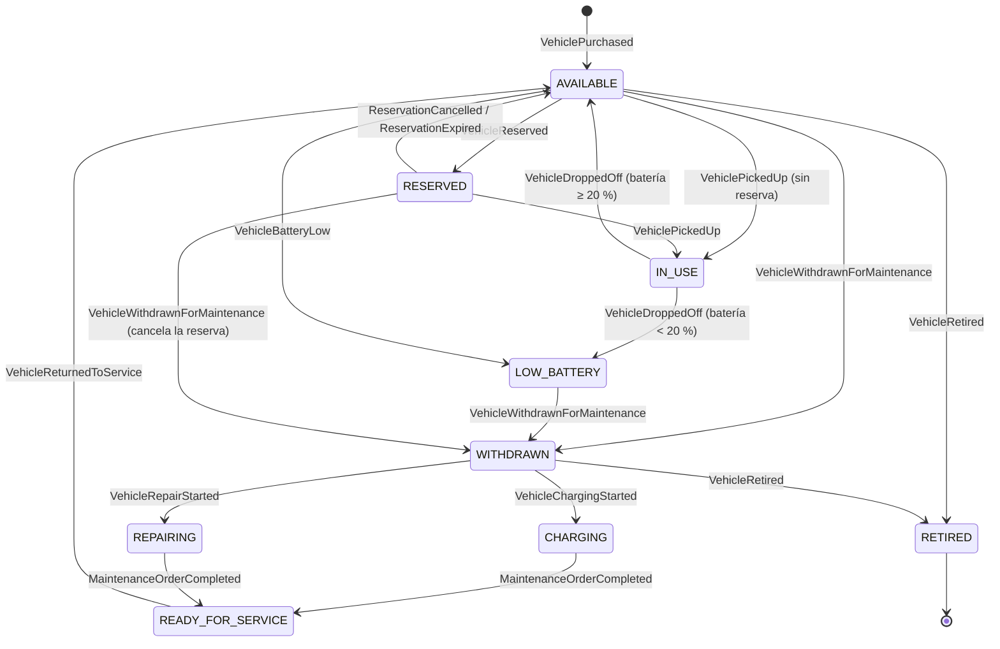

# Prototipo 1 — plataforma completa en local

> **Rama:** `prototipo1` · **Fecha:** 2026-11-23
> **Qué es:** la arquitectura de [ARCHITECTURE.md](../01-arquitectura/ARCHITECTURE.md) implementada de punta a
> punta: 13 microservicios, bus de eventos, 5 Lambdas, Data Lake, data marts y tres interfaces.

---

## 1. Arranque

Requisitos: Docker Desktop con al menos 8 GB asignados. No hace falta Java, Maven, Python ni
Terraform en la máquina: todo corre en contenedores.

```bash
docker compose up -d --build
```

(`./scripts/up.ps1` o `./scripts/up.sh` hacen lo mismo, crean `.env` si falta y muestran las URLs.)

Compose resuelve el orden solo:

1. PostgreSQL, LocalStack y Keycloak.
2. `lambda-build` (sale al terminar): empaqueta las Lambdas con sus dependencias.
3. `terraform` (sale al terminar): bus `urbanmove-bus`, una regla + cola + DLQ por consumidor,
   las 5 Lambdas y el bucket del Data Lake. Los servicios esperan a que termine
   (`service_completed_successfully`) para que los eventos semilla encuentren ya sus reglas.
4. Los 13 servicios y el gateway. La primera vez compila con Maven: varios minutos.

| Interfaz | URL | Cuenta de prueba |
|---|---|---|
| Inicio | http://localhost:8080/ | — |
| Usuario | http://localhost:8080/usuario/ | `ana` / `urbanmove`, `luis` / `urbanmove` (o registro) |
| Operaciones | http://localhost:8080/operaciones/ | `operador` / `urbanmove` (MAINTENANCE) |
| Dashboard | http://localhost:8080/dashboard/ | `gerencia` / `urbanmove` (ADMIN + MAINTENANCE) |
| Consola Keycloak | http://localhost:8081/ | `admin` / `KEYCLOAK_ADMIN_PASSWORD` del `.env` |

Las cuentas de prueba están en `infra/keycloak/realm-urbanmove.json`; son solo para local.

Parar: `docker compose down`. Borrar también los datos: `docker compose down -v`.

---

## 2. Qué hay

```text
clients/           usuario · operaciones · dashboard (HTML + JS sin build) y shared/ (estilo, vídeo, API)
libs/platform-common   sobre de evento, event store + outbox, consumidor SQS idempotente, JWT, correlación
services/<13>      un Spring Boot por servicio, una base de datos por servicio
infra/gateway      nginx: sirve las interfaces y enruta /api/* (no expone /internal/*)
infra/keycloak     realm urbanmove: roles USER, MAINTENANCE, ADMIN y usuarios semilla
infra/terraform    EventBridge, SQS + DLQ, Lambdas, S3
infra/lambdas      analytics_ingest, reservation_expiration, maintenance_detection, mart_builder, demand_relocation
scripts/up.*       arranque completo
```

### 2.1. Servicios

| Servicio | API | Publica | Consume |
|---|---|---|---|
| `identity` | `/api/auth/*`, `/api/users` | `UserRegistered`, `UserRoleAssigned` | — |
| `user-profiles` | `/api/profiles/me` | `UserProfileUpdated` | `UserRegistered` |
| `zones` | `/api/zones` | `ZoneCreated` | — |
| `inventory` | `/api/vehicles` | `VehiclePurchased`, `VehicleRetired` | — |
| `availability` | `/api/availability` | `VehicleAvailabilityChanged`, `VehicleReservationRejected`, `VehicleTransitionRejected` | 16 tipos (ver `events.tf`) |
| `telemetry` | `/api/telemetry` | `TelemetryReceived`, `VehicleBatteryLow` | — |
| `reservations` | `/api/reservations` | `VehicleReserved`, `ReservationCancelled`, `ReservationExpired`, `ReservationCompleted`, `ReservationRejected` | `VehicleAvailabilityChanged`, `VehicleReservationRejected`, `VehiclePickedUp` |
| `rides` | `/api/rides` | `VehiclePickedUp`, `VehicleDroppedOff`, `TripRecorded` | `ZoneCreated`, `VehicleAvailabilityChanged` |
| `incidents` | `/api/incidents` | `IncidentReported`, `IncidentResolved` | — |
| `maintenance` | `/api/maintenance-orders` | `MaintenanceOrderOpened`, `VehicleWithdrawnForMaintenance`, `VehicleChargingStarted`, `VehicleRepairStarted`, `MaintenanceOrderCompleted`, `VehicleReturnedToService` | — (lo llama la Lambda) |
| `relocation` | `/api/relocation-orders` | `RelocationOrderCreated`, `…Assigned`, `…Started`, `RelocationOrderCompleted` | `DemandHotspotDetected` |
| `history` | `/api/history` | — | todos |
| `analytics` | `/api/analytics/*` | — | lee marts de `analytics_db` |

### 2.2. Lambdas

| Lambda | Disparador | Hace |
|---|---|---|
| `reservation-expiration` | `VehicleReserved` → cola con retraso = TTL | Pide a reservations que expire la reserva si sigue activa |
| `maintenance-detection` | `VehicleBatteryLow`, `IncidentReported`, `TripRecorded` | Abre órdenes de carga/reparación y cuenta usos desde la última revisión |
| `analytics-ingest` | Todos los eventos | `raw/`, `trusted/` y `quarantine/` en S3 |
| `mart-builder` | Eventos de los servicios | Carga `fact_event` y reconstruye los 7 marts; publica `MartBuildCompleted` |
| `demand-relocation` | `MartBuildCompleted` | Aplica la regla de déficit y publica `DemandHotspotDetected` |

### 2.3. Ciclo de vida del vehículo (validado por `availability`)



Una transición no permitida no cambia el estado: se registra como `VehicleTransitionRejected`
(o `VehicleReservationRejected`, que hace que reservations cancele la reserva).

---

## 3. Demos guiadas

**Reserva, viaje y Data Lake.** En *Usuario* (ana): reservar → iniciar viaje → finalizar indicando la
zona de destino. En *Operaciones → Eventos*, pulsar el correlation id del viaje muestra el flujo completo.
En S3: `docker compose exec localstack awslocal s3 ls s3://urbanmove-data-lake/ --recursive`.

**Expiración.** Reservar y no hacer nada. A los `RESERVATION_TTL_SECONDS` (300 s; bájalo en `.env`
para la demo y vuelve a ejecutar el script) la Lambda la expira y el vehículo vuelve a estar disponible.

**Mantenimiento.** *Operaciones → Telemetría*: «Enviar 12 %» sobre un vehículo. La Lambda abre una orden de
carga; en *Mantenimiento*: retirar → iniciar carga → completar → devolver a la calle eligiendo zona.

**Recolocación.** Con `luis` y `ana`, reservar y cancelar varias veces en la misma zona hasta dejarla con
menos de 3 disponibles y más de 4 eventos de demanda en la última hora. Tras el siguiente build de marts,
la Lambda publica `DemandHotspotDetected` y aparece la orden en *Operaciones → Recolocación*.

**Fallo parcial.** `docker compose stop history`: los viajes siguen funcionando y los eventos se acumulan
en `history-events`. `docker compose start history` los procesa. El dashboard muestra el servicio caído.

---

## 4. Diferencias con la documentación de diseño

| Documento | Diseño | Prototipo | Motivo |
|---|---|---|---|
| ADR 0007 | Proyecciones append-only con vistas `*_current` | `event_store` append-only + tabla de estado actual por servicio | Mismo outbox y misma trazabilidad con mucho menos código; las tablas de estado se reconstruyen con un replay |
| ADR 0005 | Grafana | Dashboard propio sobre `analytics-service` | Interfaz unificada con las otras dos apps |
| ADR 0004 / ARCHITECTURE §11 | Authorization Code + PKCE | Password grant a través de `identity` | Sin redirecciones a Keycloak en el prototipo; PKCE queda pendiente |
| ARCHITECTURE §8.1 | `trusted/` y `curated/` en Parquet | `trusted/` en JSON; curated en `analytics_db` | Sin dependencias nativas en las Lambdas |
| ARCHITECTURE §7 | `MaintenanceStarted(CHARGE/REPAIR)` | `VehicleChargingStarted` / `VehicleRepairStarted` | El evento original no estaba en el catálogo y era ambiguo |
| Enunciado §8.3 | Demanda > 10 en una hora | Demanda > 4 (`demand_min_events`) | Se puede demostrar a mano; configurable en Terraform |
| ADR 0012 | `core-fleet` monolito modular | Sustituido por `availability`, `reservations` y `rides` | El código de `core-fleet` sigue en el repo, fuera de Compose |

Eventos nuevos respecto a [EVENTS.md](../01-arquitectura/EVENTS.md): `ReservationRejected`,
`ReservationCompleted`, `VehicleReservationRejected`, `VehicleTransitionRejected`, `VehicleChargingStarted`,
`VehicleRepairStarted`, `MaintenanceOrderCancelled`, `IncidentResolved`, `UserRoleAssigned`,
`RelocationOrderAssigned`, `RelocationOrderStarted`, `RelocationOrderCancelled`.

## 5. Pendiente

- Tests automáticos de los servicios nuevos (los de `core-fleet` siguen pasando).
- Contratos OpenAPI/AsyncAPI generados y Swagger detrás del gateway.
- Prometheus/Grafana técnico y despliegue en AWS.
